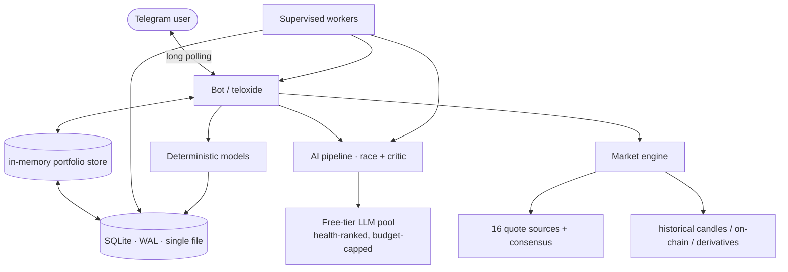

<div align="center">

# Cryptograph

**A self-hosted crypto intelligence bot for Telegram — portfolio, market data and AI analysis in one place.**

<p>
  <a href="#the-engine-deterministic-math-no-model-calls"></a>
  <a href="#the-engine-deterministic-math-no-model-calls"></a>
  <a href="#market-data"></a>
  <a href="#highlights"></a>
  <a href="LICENSE"></a>
</p>

</div>

> [!WARNING]
> **Personal project — provided as-is.**
>
> Cryptograph is a personal hobby project, published as a demo and portfolio
> piece. It is not a product: no support, no guarantees, no liability. If you
> deploy it, you are responsible for your keys, your server and your money.
>
> The output can be wrong. The deterministic models are estimates with printed
> error bars, quote providers can go stale, and language models can invent
> numbers. Treat the bot as an assistant that shows its work, not as an
> authority.

---

## Overview

A generic AI chat does not know your positions, your average entry price, today's
quotes or the latest news — so it answers from memory and invents numbers. A
portfolio tracker knows your positions but nothing about the market. A price app
knows the market but nothing about you.

Cryptograph is a single binary that closes that gap:

- **Portfolio-aware** — purchases, wallets, cost basis, average entry, P&L, and
  versioned JSON backups.
- **Market-aware** — live quotes with multi-provider consensus, historical
  candles, Fear & Greed, dominance, on-chain and derivatives metrics.
- **Deterministic where it counts** — forecasting, dip zones, the accumulation
  ladder, bottom detection, regime classification and the security scanner are
  closed-form math over local history: same input, same output, no model call,
  no quota. See [The engine](#the-engine-deterministic-math-no-model-calls).
- **AI-assisted, never AI-dependent** — language models only narrate numbers
  that were already computed, and a critic checks every figure they echo.
- **Proactive** — background workers watch your goals and the market and only
  message you when something actually matters.



---

## Highlights

| Area | What you get |
|---|---|
| **Portfolio** | Purchases, transfers, manual corrections, wallets with on-chain balances, cost basis, P&L, allocation charts |
| **Market data** | 16 free price sources merged by median with outlier rejection; short-lived consensus cache; historical candle store |
| **AI assistant** | `/ask` with conversation memory and reply-context, `/ai` deep analysis, `/advice`, `/patch` for fixing records from plain text |
| **Forecasting** | `/forecast` — a 1/3/5/7/14/30/90/180-day cone with walk-forward accuracy reporting; `/forecast verify` for the full backtest |
| **Buy-the-dip toolkit** | `/dip` zones, `/sniper` tail-risk accumulation ladder, `/bottom` "is this the bottom" radar |
| **Proactivity** | `/goal`, `/memo` and `/plan` — the AI watches conditions and speaks only when they fit |
| **News** | 14 RSS feeds, deduplicated and AI-summarized per symbol, with a security-incident scanner |
| **Trading** | Win-Win Accumulator engine (sim + live), backtests, strategy training, commander mode |
| **Reliability** | Model health tracking, quota circuit breakers, supervised workers, self-migrating schema |

---

## Market data

Quotes are fetched from **16 independent providers** and merged into a consensus
price (median with outlier rejection, so one bad feed cannot move the number):

CoinMarketCap · CoinGecko · CoinCap · CoinPaprika · Alternative.me · Binance ·
Bybit · Coinbase · OKX · Kraken · Bitfinex · Bitstamp · CryptoCompare ·
DefiLlama · DexScreener · GeckoTerminal

Providers without a configured key are skipped instead of being called just to
fail. Results land in a short-lived cache and are refreshed out-of-band by a
WebSocket stream, so consumer activity does not translate into provider load.

On top of quotes the bot keeps a local daily-candle store (`price_history`, one
row per symbol per UTC day) which powers every deterministic model, and a
derivatives feed (funding rate, open interest, long/short ratio) used by the dip
toolkit.

---

## The engine: deterministic math, no model calls

Every decision that has to be *correct* is computed, not generated. The models
below are closed-form functions of the local candle series: no network call, no
language model, no quota, and byte-identical output for identical input. AI is
used only to narrate the result.

| Layer | What it produces | Method |
|---|---|---|
| Volatility | daily sigma | 20-close sample stddev blended 50/50 with a RiskMetrics EWMA (lambda = 0.94) |
| Drift | daily log mu | weighted 20/50/200-day log returns, regime-adjusted, RSI-clamped |
| Regime | BULL / BEAR / SIDEWAYS / DIP / EUPHORIA | SMA20/50/200 structure, drawdown depth, RSI, ATH distance |
| Cone | price target + ~68% band per horizon | Student-t quantiles (nu = 4) over a drift-error-inflated sigma |
| Touch probability | P(level hit at least once) | closed-form first-passage law for Brownian motion with drift |
| Accumulation ladder | limit prices, cash weights, new average | left-tail quantiles + Martingale allocation + cost-basis algebra |
| Capitulation | 0–100 "buy now" score | Z-score, RSI, volume spike, lower wick, futures flush |
| Bottom radar | 0–100 "is this the bottom" score | capitulation + oversold + drawdown, discounted by deeper-level probability |
| Security scanner | incident topics | deterministic keyword/topic extraction with a significance gate |
| Calibration | per-symbol parameters | walk-forward grid search on the symbol's own history |

### Volatility

Daily log returns `r_t = ln(P_t / P_{t-1})`. The estimate blends a slow sample
stddev with a responsive EWMA, because the sample lags a regime change while the
EWMA overreacts to a single spike:

```text
var_ewma,t = lambda * var_ewma,t-1 + (1 - lambda) * r_t^2      lambda = 0.94
sigma_t    = 0.5 * stddev_20(r) + 0.5 * sqrt(var_ewma,t)       floor 0.3%/day
```

### Drift

```text
mu = (0.5 * r_20 + 0.3 * r_50 + 0.2 * r_200) / sum(w)
     w renormalised over the windows that are actually available
```

Then a regime term and an RSI extreme term are applied, and the result is
clamped to +/-0.5%/day so one parabolic week cannot fabricate a trend:

| Regime | Adjustment |
|---|---|
| `SIDEWAYS` | momentum zeroed — a flat market has no slope to extrapolate |
| `EUPHORIA` | x0.5, mean-reversion risk dominates near the ATH |
| `DIP` | +0.08%/day, expect a modest bounce |
| `BEAR` | -0.03%/day |
| `BULL` | +0.02%/day |
| RSI14 >= 70 / <= 30 | -/+ 0.08%/day |

Seasonality uses the **median** monthly return, capped at +/-0.02%/day. A calendar
month is roughly eight samples, so the mean is noise and the cap keeps it from
moving the model.

### The cone

Two independent uncertainties are added in quadrature: diffusion
(`sigma * sqrt(h)`) and the error of the drift estimate itself
(`(sigma / sqrt(N)) * h`, which grows linearly, not as a square root). This is
the term a plain random-walk cone ignores — and the reason 90-day coverage used
to sit near 50% instead of 68%.

```text
sigma_h = sqrt( sigma^2 * h + (sigma^2 / N) * h^2 )       N = 200
mu_h    = mu * scale / sqrt(1 + h / decay)                momentum decays with horizon
target  = P0 * exp(mu_h * h)                              cumulative drift clamped to +/-35%
band    = target * exp(+/- q * sigma_h)                   q = inv_t(0.8413, nu = 4) ~ 1.142
P(up)   = 1 - T_nu(-mu_h * h / sigma_h)
```

The Student-t quantile replaces the Gaussian 1-sigma band because crypto returns
are fat-tailed: at nu = 4 the band is ~14% wider, which is what turns an
under-covered long horizon into an honest one.

### Touch probability

For a level `L` below spot, the chance of touching it at least once within `H`
days follows the running-minimum law of Brownian motion with drift:

```text
a = ln(L / P0)
P_touch(H) = Phi((a - mu*H) / (sigma*sqrt(H)))
           + exp(2*mu*a / sigma^2) * Phi((a + mu*H) / (sigma*sqrt(H)))
```

The second term is evaluated in log space: with a small sigma and a negative
drift it otherwise overflows to `inf` while the CDF underflows to zero.

### Accumulation ladder

```text
Z14     = ln(P / anchor) / (sigma * sqrt(14))       anchor = 14-day rolling high
limit_k = P0 * exp(mu * 30 + t_k * sigma_30)        t_k = inv_t(q_k, nu = 4)
q_k     = 12% / 4% / 1%                             cash weights 20% / 35% / 45%
new_avg = (pos * avg + spend / limit) / (pos + spend / limit)
```

The anchor is a rolling high rather than the previous close, so a slow bleed does
not drag the ladder down with it. An average-entry guard re-weights the ladder
towards the deeper buckets when buying would raise the cost basis.

Capitulation score (0–100, normalised over the signals that are available):

| Signal | Points |
|---|---|
| `Z14 <= -2.0` | 40 |
| RSI14 < 25 | 25 |
| volume > SMA20 + 2 * stddev | 20 |
| lower wick > 50% of range | 15 |
| futures longs flushed | 15 |

### Bottom radar

```text
score = 55 * (capitulation / max)
      + 15 * clip((40 - RSI) / 20)
      + 15 * clip((-1 - Z14) / 1.5)
      + 5 * volume spike + 5 * long wick + 5 * OI flush
      - discount when a deeper bucket is still likely to print
```

### Futures tape

The derivatives read is a truth table, not a model output:

| Price 24h | Open interest | Read |
|---|---|---|
| <= -1% | <= -3% | longs flushed — selling is exhausting |
| <= -1% | >= +3% | shorts piling — the fall can continue |
| >= +1% | >= +3% | trend up |
| any | any, funding <= -0.015% | squeeze risk |

### Calibration and honesty

Only the geometry above is fixed. Three parameters — momentum half-life, drift
shrink and cone width — are re-fitted **per symbol** by a walk-forward grid
search over the symbol's own history (8 x 4 x 6 = 192 combinations, 400-day
window, stepped origins, no look-ahead). The objective penalises a dishonest
cone as much as a wrong point estimate:

```text
score = MAPE + 0.5 * miss_rate + 1.0 * |coverage - 0.68|
      + 2.0 * mean_h |coverage_h - 0.68|
```

The last term is per horizon, so five well-covered short horizons cannot hide an
under-covered quarter.

Every report then prints the model's **realised** out-of-sample numbers per
horizon: direction hit rate with a Wilson interval, MAPE, and cone coverage —
recomputed on the freshest history at call time, not a stored claim. The same
replay is available offline with `cryptograph forecast verify BTC`.

### Horizon profiles

| Symbols | Ladder | Rationale |
|---|---|---|
| BTC, ETH | 1 · 3 · 5 · 7 · 14 · 30 · 90 · 180 days | a decade of daily closes |
| SOL, LINK | 1 · 3 · 5 · 7 · 14 · 30 · 60 · 90 days | younger listings |
| anything else | 1 · 3 · 5 · 7 · 14 · 30 days, capped at history/4 | no data to support a quarter claim |

### Security scanner

Incident detection does not depend on a model's severity judgement (a frontier
model once returned `none` for a record-breaking exchange breach). A deterministic
pass extracts the incident class and the affected entity from cached headlines,
then gates on significance: custody providers always qualify, wallet brands only
on an active-compromise word, generic classes only above a large loss threshold.
Topics are deduplicated per incident, so one event produces one message.

---

## Commands

Full reference with examples: **[docs/commands.md](docs/commands.md)**.

### Market

| Command | Description |
|---|---|
| `/price [SYMS]` | Live quotes, 24h changes, ATH discount |
| `/top [N]` | Top coins by 24h volume |
| `/convert 100 BYN BTC` | Currency converter |
| `/fng` | Fear & Greed Index |
| `/news [SYM]` | AI-summarized news for a symbol |

### Portfolio

| Command | Description |
|---|---|
| `/portfolio` | Holdings, values, P&L |
| `/pnl` | P&L timeline chart (PNG) |
| `/distribution` | Allocation donut (PNG) |
| `/add BTC 0.01 600 hot:binance` | Record a purchase |
| `/move BTC 0.5 from:ledger to:binance fee:0.0001` | Transfer between wallets |
| `/adjust wallet:ledger BTC 0.9999` | Set a balance manually |
| `/correct #5 amount 0.02` | Edit a purchase record |
| `/invested BTC 5000` | Override total invested |
| `/history` | Purchase history and per-asset averages |
| `/watchlist add ETH` | Watchlist management |
| `/wallet add cold:ledger BTC bc1q...` | Register a wallet (optional on-chain sync) |

### Analysis

| Command | Description |
|---|---|
| `/ask <question>` | Portfolio-aware AI answer; plain text works too, and replying to any message continues the thread |
| `/ai [SYM]` | Deep multi-asset analysis |
| `/advice` | Long-term investment intelligence |
| `/patch <text>` | Fix portfolio records from plain language |
| `/forecast [SYMS]` | Horizon ladder with a 68% cone, probabilities and walk-forward accuracy |
| `/forecast verify` | Backtest of the shipped model on realized history |
| `/dip [SYMS]` | Dip zones, first-passage touch probabilities, buy/split/wait verdict |
| `/sniper [SYMS]` | Tail-risk accumulation: cash pool, three left-tail buckets, capitulation score |
| `/bottom [SYMS]` | Bottom radar: 0–100 score and a concrete level to buy at |

### Proactive & system

| Command | Description |
|---|---|
| `/goal <text>` | Standing goal the AI watches and reports on |
| `/memo <text>` | Permanent rule the AI always remembers |
| `/plan` | Dashboard over goals, memo rules and alerts |
| `/alert add BTC < 60000 cooldown:6h` | Price alerts with per-rule cooldown |
| `/trade`, `/tradetask` | Trading module (simulation by default) |
| `/settings` | Interactive settings, including model health and source reliability |
| `/model list` \| `/model set N` | Choose the preferred model |
| `/ver` | Build version and git hash |
| `/backup`, `/restore` | Versioned JSON backup and restore |
| `/allow`, `/revoke`, `/acl`, `/reset` | Admin access control and cache reset |

---

## AI pipeline

- **Numbers first, prose second**: the prompt is grounded in a pre-computed
  snapshot, two generators race, a reviewer merges them, and a critic validates
  every figure against the snapshot. Hallucinated prices are corrected or
  rejected rather than passed through.
- **Free tiers first**: providers are ranked by measured health and cost, paid
  capacity is an optional last resort with a hard budget enforced in code.
- **Quota-aware**: a provider-wide quota parks that provider until its reset time
  instead of retrying every cycle. Oversized prompts are rejected locally before
  spending quota.
- **Self-tuning registry**: `models refresh|rank|stats|calibrate` discovers free
  models, benchmarks a small number per day with a cooldown, and assigns roles
  (`main`, `critic`, `news`, `watcher`).
- **Self-healing**: health comes from real traffic only, failing models cool down,
  workers restart on panic with backoff, and the schema migrates on boot.

---

## Background workers

| Worker | Purpose |
|---|---|
| Alert engine | Evaluates price alerts against cached quotes |
| Security scanner | Deterministic incident detection over cached news, significance-gated and deduplicated per incident |
| News worker | Fetches the RSS set, dedupes, AI-summarizes per symbol |
| Market intel | On-chain and derivatives metrics, stored raw |
| AI watcher | Market-wide analysis with severity levels |
| Macro worker | Macro regime context |
| Dip worker | Dip-zone scan; alerts only at/below average entry |
| Proactive worker | Goal/memo evaluation with anti-FOMO guardrails |
| Model ranker | Registry refresh and lazy benchmarking |
| Wallet poller | On-chain balance verification |

All workers are supervised: panics restart with backoff, and observation
frequency is internal — the cadence adapts to volatility instead of being a knob
to configure.

---

## Configuration

| Variable | Required | Purpose |
|---|---|---|
| `TELOXIDE_TOKEN` | ✅ | Telegram bot token |
| `ALLOWED_ADMIN_IDS` | ✅ | Comma-separated Telegram user IDs allowed to use the bot |
| `CMC_API_KEY` | ✅ | CoinMarketCap key (free tier is fine) |
| `GEMINI_API_KEY` | ◻️ | Free AI tier, strongly recommended |
| additional free AI tiers | ◻️ | One key per provider; the registry ranks them at runtime |
| `OPENROUTER_API_KEY` | ◻️ | Free-model discovery and ranking; hard budget |
| `DEEPSEEK_API_KEY` | ◻️ | Optional paid last resort, budget-capped |
| `COINGECKO_API_KEY`, `COINCAP_API_KEY`, `CRYPTOCOMPARE_API_KEY` | ◻️ | Additional price/history sources |
| `HELIUS_API_KEY`, `ANKR_RPC_URL` | ◻️ | On-chain wallet balances |
| `TAVILY_API_KEY`, `EXA_API_KEY` | ◻️ | Web search for the AI |
| `SQLITE_DB` | ◻️ | Database path (`crypto.db` locally, `/app/data/crypto.db` in Docker) |
| `CRYPTOGRAPH_HISTORY_DIR` | ◻️ | Daily-close CSV cache (`data/history` locally, `/app/history` in Docker) |
| `CRYPTOGRAPH_ENABLE_COINCAP` | ◻️ | Set to `1` to re-enable the CoinCap provider |

See `.env.example` for the full template.

---

## Deployment

### Local

```bash
cp .env.example .env     # fill in the keys
cargo run
```

### Production (Docker)

```bash
# On the build machine
./build_dist.ps1                      # packages source + models.json into dist/

# On the server
chmod +x run.sh
GIT_HASH=$(git rev-parse --short HEAD) ./run.sh
```

`run.sh` builds the image with the git hash baked into `/ver`, recreates the
container and prunes dangling images. The SQLite volume and history cache live
outside the image, so a redeploy never touches your data.

A hardened systemd unit is provided in `systemd/` for bare-metal installs.

### Verifying a deployment

```bash
docker compose -f docker-compose.yml exec -T cryptograph /app/cryptograph version
docker inspect cryptograph --format 'restarts={{.RestartCount}} status={{.State.Status}}'
```

---

## CLI diagnostics

Every subsystem is reachable without Telegram, which makes production
verification and prompt debugging straightforward:

```bash
cryptograph version                       # same identity /ver reports
cryptograph forecast BTC ETH              # horizon ladder + cone + accuracy
cryptograph forecast verify BTC           # walk-forward backtest
cryptograph dip BTC                       # dip zones and touch probabilities
cryptograph sniper BTC cash=1000 avg=64255 pos=0.5
cryptograph bottom BTC cash=1000 avg=64255
cryptograph backtest BTC ETH SOL LINK     # shipped vs calibrated model
cryptograph analyze BTC                   # deep AI analysis in the terminal
cryptograph ask demo "should I buy more?" # full /ask pipeline, stage by stage
cryptograph ask 123456789 "question" reply="[assistant (bot)]: ..."
cryptograph goal demo -v                  # proactive scan, every stage printed
cryptograph scenario scenarios/euphoria.json "buy now?" --fast
cryptograph search "ETH news"              # inspect the web-search flow only
cryptograph news summary|history|articles|cleanup
cryptograph models refresh|list|rank|stats|calibrate
cryptograph trade status                   # trading module (simulation by default)
cryptograph wipe-knowledge                 # reset caches, keep users/goals/memos
```

---

## Data and privacy

- Everything lives in a **single local SQLite file** (WAL mode). No third party
  sees your positions; there is no hosted component.
- Backups are portable, versioned **JSON** files. They are **not encrypted** —
  treat them as sensitive.
- Secrets live only in `.env`, which is gitignored. The session key is generated
  per process; there is no master key to store.
- Access is restricted to `ALLOWED_ADMIN_IDS`, with `/allow`, `/revoke` and
  `/acl` for runtime management.

---

## Documentation

| Document | Contents |
|---|---|
| [Command reference](docs/commands.md) | Every Telegram command and CLI mode, with examples |
| [Model mathematics](docs/models.md) | Formulas, constants, calibration and accuracy methodology |
| [Features](docs/features.md) | Detailed behaviour of each subsystem |
| [Architecture](docs/architecture.md) | Components, data flow, worker topology |
| [System guide](docs/system_guide.md) | Database schema and algorithmic workflows |
| [AI pipeline](docs/ai_pipeline_guide.md) | Model pools, routing, budgets, failure handling |
| [AI payloads](docs/ai_payloads.md) | Exactly what is sent to models: prompt blocks and wire format |
| [AI analytics](docs/ai_analytics.md) | MoE pipeline and scoring internals |
| [System brain](docs/system_brain_guide.md) | Scheduler and worker supervision |
| [Database](docs/database.md) | Schema reference |
| [Installation](docs/installation.md) | Build, deploy, update, troubleshoot |
| [Backup & restore](docs/backup_restore_guide.md) | JSON backup format and recovery |
| [Trading module](docs/trading/README.md) | Win-Win Accumulator: engine, invariants, backtests |

---

## License

**AGPL-3.0** — free to use, modify and self-host. If you run a modified version
as a network service, you must publish your changes under the same license.
