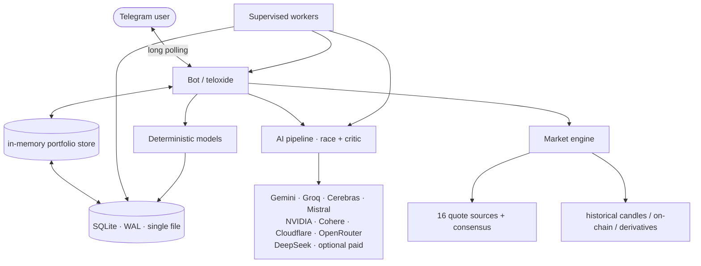

<div align="center">

# Cryptograph

**A self-hosted crypto intelligence bot for Telegram — portfolio, market data and AI analysis in one place.**

[](#)
[](LICENSE)
[](#)
[](#market-data)

</div>

> [!WARNING]
> **Personal project — provided as-is.**
>
> Cryptograph is a hobby project written for personal use. It is not maintained
> as a product: no support, no guarantees, no liability. If you deploy it, you
> are responsible for your keys, your server and your money.
>
> Cryptograph is **not financial advice**. It is an assistant: language models
> hallucinate, providers go stale, and models make mistakes. Never invest based
> on a bot's output.

---

## Overview

A generic AI chat does not know your positions, your average entry price, today's
quotes or the latest news — so it answers from memory and invents numbers. A
portfolio tracker knows your positions but nothing about the market. A price app
knows the market but nothing about you.

Cryptograph is a single binary that closes that gap:

- **Portfolio-aware** — purchases, wallets, cost basis, average entry, P&L, and
  versioned JSON backups.
- **Market-aware** — live quotes with multi-provider consensus, historical
  candles, Fear & Greed, dominance, on-chain and derivatives metrics.
- **AI-assisted** — every prompt is grounded in a pre-computed snapshot of that
  data, then generated by two racing models and fact-checked by a critic.
- **Proactive** — background workers watch your goals and the market and only
  message you when something actually matters.
- **Deterministic where it counts** — forecasting, dip zones and bottom detection
  are plain math over local history: reproducible, no AI, no API quota.



---

## Highlights

| Area | What you get |
|---|---|
| **Portfolio** | Purchases, transfers, manual corrections, wallets with on-chain balances, cost basis, P&L, allocation charts |
| **Market data** | 16 free price sources merged by median with outlier rejection; 180 s cache; historical candle store |
| **AI assistant** | `/ask` with conversation memory and reply-context, `/ai` deep analysis, `/advice`, `/patch` for fixing records from plain text |
| **Forecasting** | `/forecast` — a 1/3/5/7/14/30/90/180-day cone with walk-forward accuracy reporting; `/forecast verify` for the full backtest |
| **Buy-the-dip toolkit** | `/dip` zones, `/sniper` tail-risk accumulation ladder, `/bottom` "is this the bottom" radar |
| **Proactivity** | `/goal`, `/memo` and `/plan` — the AI watches conditions and speaks only when they fit |
| **News** | 14 RSS feeds, deduplicated and AI-summarized per symbol, with a security-incident scanner |
| **Trading** | Win-Win Accumulator engine (sim + live), backtests, strategy training, commander mode |
| **Reliability** | Model health tracking, quota circuit breakers, supervised workers, self-migrating schema |

---

## Market data

Quotes are fetched from **16 independent providers** and merged into a consensus
price (median with outlier rejection, so one bad feed cannot move the number):

CoinMarketCap · CoinGecko · CoinCap · CoinPaprika · Alternative.me · Binance ·
Bybit · Coinbase · OKX · Kraken · Bitfinex · Bitstamp · CryptoCompare ·
DefiLlama · DexScreener · GeckoTerminal

Providers without a configured key are skipped instead of being called just to
fail. Results are cached for 180 s and refreshed out-of-band by a Binance
WebSocket stream, so polling interval does not translate into provider load.

On top of quotes the bot keeps a local daily-candle store (`price_history`,
one row per symbol per UTC day, 400-day retention) which powers every
deterministic model, and a derivatives feed (funding rate, open interest,
long/short ratio) used by the dip toolkit.

---

## Commands

Full reference with examples: **[docs/commands.md](docs/commands.md)**.

### Market

| Command | Description |
|---|---|
| `/price [SYMS]` | Live quotes, 24h changes, ATH discount |
| `/top [N]` | Top coins by 24h volume |
| `/convert 100 BYN BTC` | Currency converter |
| `/fng` | Fear & Greed Index |
| `/news [SYM]` | AI-summarized news for a symbol |

### Portfolio

| Command | Description |
|---|---|
| `/portfolio` | Holdings, values, P&L |
| `/pnl` | P&L timeline chart (PNG) |
| `/distribution` | Allocation donut (PNG) |
| `/add BTC 0.01 600 hot:binance` | Record a purchase |
| `/move BTC 0.5 from:ledger to:binance fee:0.0001` | Transfer between wallets |
| `/adjust wallet:ledger BTC 0.9999` | Set a balance manually |
| `/correct #5 amount 0.02` | Edit a purchase record |
| `/invested BTC 5000` | Override total invested |
| `/history` | Purchase history and per-asset averages |
| `/watchlist add ETH` | Watchlist management |
| `/wallet add cold:ledger BTC bc1q...` | Register a wallet (optional on-chain sync) |

### Analysis

| Command | Description |
|---|---|
| `/ask <question>` | Portfolio-aware AI answer; plain text works too, and replying to any message continues the thread |
| `/ai [SYM]` | Deep multi-asset analysis |
| `/advice` | Long-term investment intelligence |
| `/patch <text>` | Fix portfolio records from plain language |
| `/forecast [SYMS]` | Horizon ladder with a 68% cone, probabilities and walk-forward accuracy |
| `/forecast verify` | Backtest of the shipped model on realized history |
| `/dip [SYMS]` | Dip zones, first-passage touch probabilities, buy/split/wait verdict |
| `/sniper [SYMS]` | Tail-risk accumulation: cash pool, three left-tail buckets, capitulation score |
| `/bottom [SYMS]` | Bottom radar: 0–100 score and a concrete level to buy at |

### Proactive & system

| Command | Description |
|---|---|
| `/goal <text>` | Standing goal the AI watches and reports on |
| `/memo <text>` | Permanent rule the AI always remembers |
| `/plan` | Dashboard over goals, memo rules and alerts |
| `/alert add BTC < 60000 cooldown:6h` | Price alerts with per-rule cooldown |
| `/trade`, `/tradetask` | Trading module (simulation by default) |
| `/settings` | Interactive settings, including model health and source reliability |
| `/model list` \| `/model set N` | Choose the preferred model |
| `/ver` | Build version and git hash |
| `/backup`, `/restore` | Versioned JSON backup and restore |
| `/allow`, `/revoke`, `/acl`, `/reset` | Admin access control and cache reset |

---

## Deterministic models

These are pure functions over the local candle history — no AI call, no network
call, identical output for identical input.

**`/forecast`** builds a horizon ladder using log-drift with horizon damping and
a volatility cone. The cone uses a Student-t quantile (ν = 4) rather than a
Gaussian 1σ and adds the drift's own estimation error in quadrature, so long
horizons are not artificially tight; volatility blends a 20-close standard
deviation with a RiskMetrics EWMA. In a `SIDEWAYS` regime momentum is zeroed —
a flat market has no trend to extrapolate. Seasonality is reported as median and
win rate and is capped at a 0.02%/day drift contribution (a calendar month is
roughly 8 samples: not a signal). Damping, drift shrink and cone width are
walk-forward calibrated per symbol, and every message reports the model's real
out-of-sample direction hit rate, MAPE and cone coverage per horizon.

**`/dip`** derives support levels from SMA50/200, recent lows and the forecast
cone, then prices each one with a closed-form first-passage probability of being
touched within 1/3/7/14/30 days. The verdict (`BUY` / `SPLIT` / `WAIT` /
`NO-BUY`) is relative to your own average entry.

**`/sniper`** implements a tail-risk accumulation ladder: a 14-day drawdown
Z-score anchored to a rolling high, three limit buckets at 12% / 4% / 1%
Student-t quantiles with Martingale-weighted cash allocation, an average-entry
guard that flags buckets which would dilute your cost basis on paper, and a
0–100 capitulation score for "buy now" conditions.

**`/bottom`** condenses the same inputs into one explicit answer: how deep this
is, whether a deeper bucket is still likely to print, and the price at which
buying makes statistical sense.

---

## AI pipeline

- **Two generators race**, a reviewer merges them, and a critic validates every
  number against the ground-truth snapshot. Hallucinated prices are corrected or
  rejected rather than passed through.
- **Free tiers first**: Gemini, Groq, Cerebras, NVIDIA, Mistral, Cohere,
  Cloudflare, Hugging Face, OpenRouter free. DeepSeek is an optional paid last
  resort with a hard monthly budget enforced in code (default 3M tokens / 150
  requests); OpenRouter has a hard daily cap (default 300 requests).
- **Quota-aware**: exhaustion of a provider-wide quota parks that provider until
  its reset time instead of retrying every cycle. Oversized prompts are rejected
  locally before spending quota.
- **Self-tuning model registry**: `models refresh|rank|stats|calibrate`
  discovers free models, benchmarks at most three per day with a 30-day cooldown,
  and assigns roles (`main`, `critic`, `news`, `watcher`).
- **Self-healing**: model health comes from real traffic only, failing models get
  a cooldown, workers restart on panic with backoff, and the schema migrates
  itself on boot.

---

## Background workers

| Worker | Interval | Purpose |
|---|---|---|
| Alert engine | 60 s tick | Evaluates price alerts against cached quotes |
| Security scanner | 15 min | Deterministic incident detection over cached news, significance-gated, max one digest per 6 h |
| News worker | 2 h (1 h when volatile) | Fetches 14 RSS feeds, dedupes, AI-summarizes per symbol |
| Market intel | 60 min (30 min when volatile) | On-chain and derivatives metrics, stored raw |
| AI watcher | 4 h (2 h when volatile) | Market-wide analysis with severity levels |
| Macro worker | 12 h (4 h when volatile) | Macro regime context |
| Dip worker | 24 h | Dip-zone scan; alerts only at/below average entry |
| Proactive worker | per goal | Goal/memo evaluation with anti-FOMO guardrails |
| Model ranker | daily | Registry refresh and lazy benchmarking |
| Wallet poller | 15 min | On-chain balance verification |

---

## Configuration

| Variable | Required | Purpose |
|---|---|---|
| `TELOXIDE_TOKEN` | ✅ | Telegram bot token |
| `ALLOWED_ADMIN_IDS` | ✅ | Comma-separated Telegram user IDs allowed to use the bot |
| `CMC_API_KEY` | ✅ | CoinMarketCap key (free tier is fine) |
| `GEMINI_API_KEY` | ◻️ | Free AI tier, strongly recommended |
| `GROQ_API_KEY`, `CEREBRAS_API_KEY`, `NVIDIA_API_KEY`, `MISTRAL_API_KEY`, `COHERE_API_KEY`, `CLOUDFLARE_API_TOKEN` + `CLOUDFLARE_ACCOUNT_ID`, `HF_API_KEY` | ◻️ | Additional free AI tiers |
| `OPENROUTER_API_KEY` | ◻️ | Free-model discovery and ranking; hard daily budget |
| `DEEPSEEK_API_KEY` | ◻️ | Optional paid last resort, budget-capped |
| `COINGECKO_API_KEY`, `COINCAP_API_KEY`, `CRYPTOCOMPARE_API_KEY` | ◻️ | Additional price/history sources |
| `HELIUS_API_KEY`, `ANKR_RPC_URL` | ◻️ | On-chain wallet balances |
| `TAVILY_API_KEY`, `EXA_API_KEY` | ◻️ | Web search for the AI |
| `SQLITE_DB` | ◻️ | Database path (`crypto.db` locally, `/app/data/crypto.db` in Docker) |
| `CRYPTOGRAPH_HISTORY_DIR` | ◻️ | Daily-close CSV cache (`data/history` locally, `/app/history` in Docker) |
| `ALERT_INTERVAL_SECS` | ◻️ | Alert tick in seconds (default 60, minimum 30) |
| `WALLET_POLL_MINS` | ◻️ | On-chain wallet poll interval (default 15) |
| `CRYPTOGRAPH_ENABLE_COINCAP` | ◻️ | Set to `1` to re-enable the CoinCap provider |

See `.env.example` for the full template.

---

## Deployment

### Local

```bash
cp .env.example .env     # fill in the keys
cargo run
```

### Production (Docker)

```bash
# On the build machine
./build_dist.ps1                      # packages source + models.json into dist/

# On the server
chmod +x run.sh
GIT_HASH=$(git rev-parse --short HEAD) ./run.sh
```

`run.sh` builds the image with the git hash baked into `/ver`, recreates the
container and prunes dangling images. The SQLite volume and history cache live
outside the image, so a redeploy never touches your data.

A hardened systemd unit is provided in `systemd/` for bare-metal installs.

### Verifying a deployment

```bash
docker compose -f docker-compose.yml exec -T cryptograph /app/cryptograph version
docker inspect cryptograph --format 'restarts={{.RestartCount}} status={{.State.Status}}'
```

---

## CLI diagnostics

Every subsystem is reachable without Telegram, which makes production
verification and prompt debugging straightforward:

```bash
cryptograph version                       # same identity /ver reports
cryptograph forecast BTC ETH              # horizon ladder + cone + accuracy
cryptograph forecast verify BTC           # walk-forward backtest
cryptograph dip BTC                       # dip zones and touch probabilities
cryptograph sniper BTC cash=1000 avg=64255 pos=0.5
cryptograph bottom BTC cash=1000 avg=64255
cryptograph backtest BTC ETH SOL LINK     # shipped vs calibrated model
cryptograph analyze BTC                   # deep AI analysis in the terminal
cryptograph ask demo "should I buy more?" # full /ask pipeline, stage by stage
cryptograph ask 123456789 "question" reply="[assistant (bot)]: ..."
cryptograph goal demo -v                  # proactive scan, every stage printed
cryptograph scenario scenarios/euphoria.json "buy now?" --fast
cryptograph search "ETH news"              # inspect the web-search flow only
cryptograph news summary|history|articles|cleanup
cryptograph models refresh|list|rank|stats|calibrate
cryptograph trade status                   # trading module (simulation by default)
cryptograph wipe-knowledge                 # reset caches, keep users/goals/memos
```

---

## Data and privacy

- Everything lives in a **single local SQLite file** (WAL mode). No third party
  sees your positions; there is no hosted component.
- Backups are portable, versioned **JSON** files. They are **not encrypted** —
  treat them as sensitive.
- Secrets live only in `.env`, which is gitignored. The session key is generated
  per process; there is no master key to store.
- Access is restricted to `ALLOWED_ADMIN_IDS`, with `/allow`, `/revoke` and
  `/acl` for runtime management.

---

## Documentation

| Document | Contents |
|---|---|
| [Command reference](docs/commands.md) | Every Telegram command and CLI mode, with examples |
| [Features](docs/features.md) | Detailed behaviour of each subsystem |
| [Architecture](docs/architecture.md) | Components, data flow, worker topology |
| [System guide](docs/system_guide.md) | Database schema and algorithmic workflows |
| [AI pipeline](docs/ai_pipeline_guide.md) | Model pools, routing, budgets, failure handling |
| [AI analytics](docs/ai_analytics.md) | MoE pipeline and scoring internals |
| [System brain](docs/system_brain_guide.md) | Scheduler and worker supervision |
| [Database](docs/database.md) | Schema reference |
| [Installation](docs/installation.md) | Build, deploy, update, troubleshoot |
| [Backup & restore](docs/backup_restore_guide.md) | JSON backup format and recovery |
| [Trading module](docs/trading/README.md) | Win-Win Accumulator: engine, invariants, backtests |

---

## License

**AGPL-3.0** — free to use, modify and self-host. If you run a modified version
as a network service, you must publish your changes under the same license.
