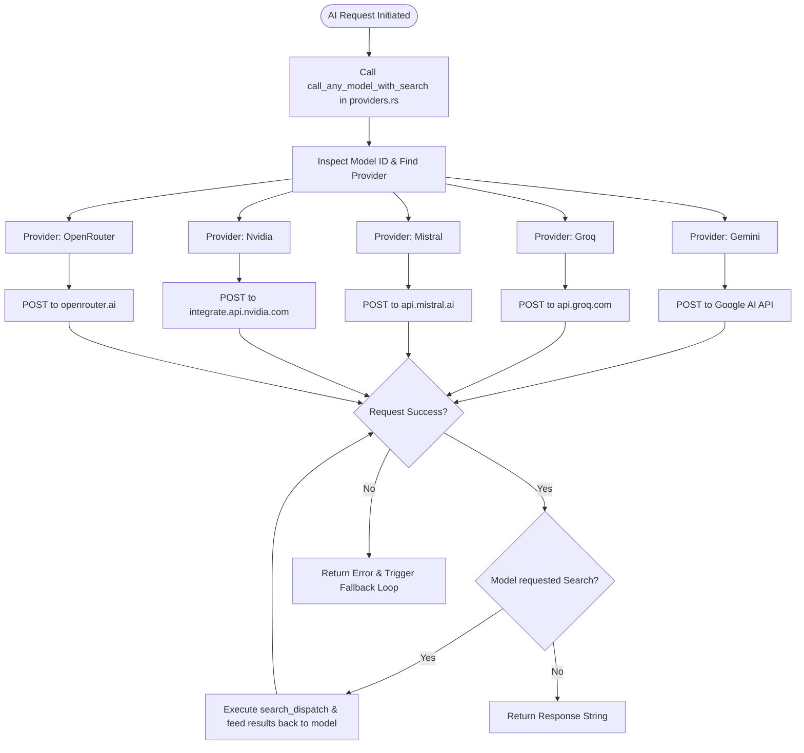
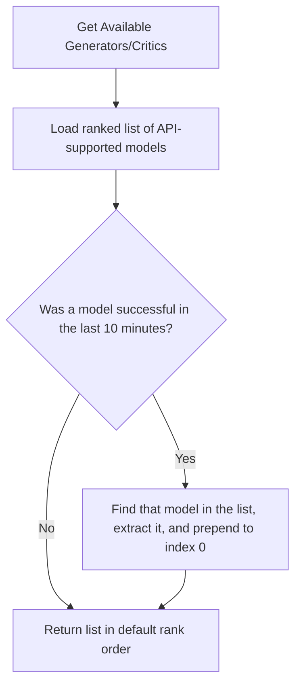
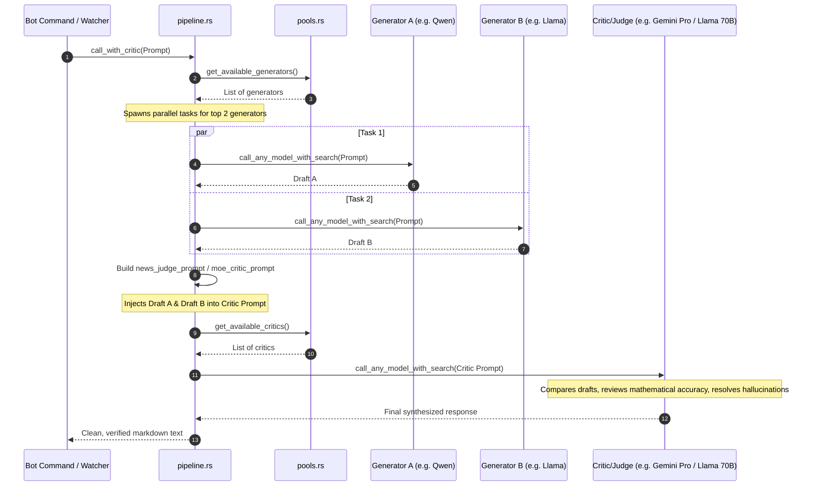

# Cryptograph AI Pipeline & Model Orchestration Guide

This guide details the inner workings of Cryptograph's Artificial Intelligence features, explaining the request lifecycle, news aggregation decision structures, model pool selection, fallback routing mechanics, search tool integration, and database resilience.

---

## 🛠️ 1. AI Request Lifecycle & Routing

When an AI operation is requested (e.g., news consolidation, portfolio analysis, or price alert commentary), the request goes through the following lifecycle:

### API Payload Mapping
Each provider has a specific request schema mapped in `src/crypto/ai/providers.rs`.
- **Gemini**: Standard `v1beta/models` endpoint using `generateContent`.
- **Groq, Mistral, Nvidia, OpenRouter**: Compatible with OpenAI-style `v1/chat/completions` REST format.

---

## 🧠 2. Model Pool Selection & Success Promotion

To optimize cost, throughput, and reliability, model IDs are separated into two distinct pools in `src/crypto/ai/pools.rs`:
1. **Generators**: Lightweight, cost-efficient, and fast models (e.g., Llama 3.3, Qwen 2.5, Gemini Flash) designed to draft initial responses.
2. **Critics**: Heavy, high-parameter reasoning models (e.g., Llama 3.3 70B Instruct, Mistral Large, DeepSeek Pro, Gemini Pro) designed to fact-check, critique, and synthesize.

### Dynamic Success Promotion Algorithm
To avoid hitting failing models repeatedly, Cryptograph remembers the last model that successfully answered a request using thread-safe `Mutex` timers.

---

## 📰 3. News Processing & Decision Pipeline

The background News Worker (`src/crypto/ai/news_worker.rs`) executes periodically.

### Adaptive Scheduling
* **Default Interval:** Every **2 hours**.
* **Volatility Override:** The worker checks hourly changes of watched assets. If any asset changes $\ge 2\%$ in 1 hour or $\ge 5\%$ in 24 hours, the interval is automatically shortened to **1 hour** to keep news fresh.

### Parallel RSS Feed Aggregation (6 Sources)
If the CryptoCompare API fails or is unconfigured, the News Worker fetches news from 6 parallel feeds:
* CoinTelegraph
* CoinDesk
* Decrypt
* Blockworks
* The Block
* Bitcoin Magazine

Articles are merged, parsed, and deduplicated before being sent to the MoE pipeline.

---

## 👥 4. Mixture of Experts (MoE) Execution Flow

For complex user queries (e.g., `/ai <SYMBOL>` or portfolio risk analysis), the bot runs a full **Generator-Critic** validation loop (`src/crypto/ai/pipeline.rs`):

---

## 🔍 5. Web Search Tool Integration & Budgets

When models process prompts, they can request real-time search queries to lookup recent events.

### The Search Loop
1. **Trigger:** The model outputs a line matching `SEARCH: <query>`.
2. **Execution:** The execution loop intercepts the token and forwards the query to `search_dispatch` in `src/crypto/ai/search/dispatcher.rs`.
3. **Consolidation:** The search results are parsed, formatted into `SEARCH_RESULT` blocks, appended to the prompt, and sent back to the model for final generation.

### Search Providers & Failover
1. **Tavily** (primary API)
2. **Exa** (secondary API fallback)
3. **Local Search** (Nongreedy web parser targeting DuckDuckGo HTML and Yahoo, requiring no API keys)

### Search Budgets
A `BudgetManager` limits calls per request to protect API balances:
* **Tavily:** Max 3 calls per request.
* **Exa:** Max 3 calls per request.
* **Local:** Max 10 calls per request.

### Dynamic Local Search Depth
Local search uses context keywords to optimize token usage:
* **Normal queries:** Returns **5** results to conserve prompt tokens.
* **Detailed/Comparative queries** (containing words like *detail, compare, comparison, full, list, all, анализ, сравн, подробн, все*): Automatically fetches **10** results to provide the models with deep analytical context.

---

## 💾 6. Database Schema & Resilience

The database layer (`src/db/sqlite.rs`) uses SQLite in Write-Ahead Logging (WAL) mode for fast, concurrent access.

### Database Integrity & Self-Healing
On application startup, the SQLite connection manager validates database health:
1. **Integrity Check:** Runs `PRAGMA integrity_check;`.
2. **Automatic Recovery:** If corruption is detected, the manager closes the connection, renames the corrupt file to `crypto.db.corrupt.<timestamp>`, and boots a clean, fresh database to prevent server downtime.
3. **Safe Auto-Migrations:** Schema updates are executed using `CREATE TABLE IF NOT EXISTS` and `ALTER TABLE ... ADD COLUMN ...` (ignoring existing column errors) to safely add new columns without affecting existing user portfolios or cached data.
