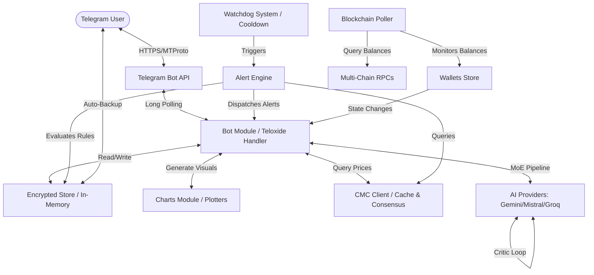

# Cryptograph Architecture

> [!NOTE]
> For a detailed walkthrough of all database schemas, news aggregation engines, and consensus algorithms (complete with Mermaid diagrams), refer to the **[Complete System Guide](docs/system_guide.md)**.

Cryptograph is a zero-trust, memory-first crypto portfolio intelligence Telegram bot built in Rust. It compiles to a highly efficient binary (~8MB) and is designed for maximum privacy, security, and low latency.

## Core Components

### 1. Telegram Bot & FSM Engine (`src/bot/`)
- **Framework**: `teloxide` library utilizing long-polling.
- **Access Control (ACL)**: A strict middleware system restricts access only to IDs listed in `ALLOWED_ADMIN_IDS`. Unapproved users are rejected at the entry point.
- **FSM Wizard Workflow**: Implements a State Machine for multi-step interactive workflows (e.g., adding price alerts or registering cold/hot wallets step-by-step) avoiding raw slash-command parameters.
- **NLP Engine**: Simple token-matching parser that converts conversational text inputs into matching structured commands.

### 2. Store & Backups (`src/db/`)
- **In-Memory Architecture**: Portfolio data lives in RAM while the bot runs and is persisted to SQLite for restart recovery.
- **Versioned JSON Backups**: State changes trigger an automatic backup flow. The portfolio is serialized with `serde_json` into a schema-tagged `BackupEnvelope` and sent to the user as a `cryptograph_backup.json` document (legacy `.cgrp` files are still accepted on restore). The backup is plain JSON, **not encrypted**.

### 3. CoinMarketCap Client (`src/crypto/`)
- **Consensus Quotes**: Fetches cryptocurrency rates and volumes. Implements outlier exclusion algorithms (median calculation) when multiple APIs are polled to prevent manipulation or single point of failure anomalies.
- **In-Memory Caching**: Implements a TTL cache for real-time prices (60 seconds) and market metrics (5 minutes) to stay well within rate-limit budgets (free tier friendly).
- **BYN/USD Live Conversion**: Automatically queries the Belarus National Bank (NBRB) API daily to parse official exchange rates for accurate BYN local valuation.
- **Deduplicated News Aggregator**: Features a parallelized aggregator polling CoinTelegraph, CoinDesk, Decrypt, and Blockworks RSS feeds simultaneously using `tokio::join!`. The results are merged and deduplicated by title to construct a news context of up to 40 articles, bypassing CryptoCompare rate limits.

### 4. Alert & Watchdog System (`src/alerts/`)
- **Alert Engine**: Wakes up periodically (default: 5 minutes) via a background tokio interval task.
- **Deduplication & Cooldown**: Smart checks ensure price fluctuations close to alert margins don't flood the user. Alerts only trigger if the condition is met in two consecutive checks and after the user-configured cooldown period (default: 12h) has elapsed.

### 5. Blockchain Balance Poller (`src/crypto/blockchain.rs`)
- Wakes up periodically (default: 15 minutes) to verify balances of registered on-chain wallets (EVM, Solana, Bitcoin, Tron) utilizing public explorer APIs.
- Auto-updates cached balances and notifies users on changes.

### 6. AI Agent Pipeline (`src/crypto/ai/`)
- **Generator-Critic Architecture**: Uses a Mixture of Experts (MoE) approach. The "Writer" model generates an initial draft, and the "Judge" model critiques and validates it to ensure zero hallucinations and logical consistency.
- **Provider Fallback Pool**: Automatically falls back across multiple providers (Gemini, Groq, Mistral, Nvidia, OpenRouter) to ensure 100% uptime in case of API outages or rate limits (`429 Too Many Requests`).
- **Cost-Optimized Model Selection**: For news aggregation and summarization, cheap models (like Qwen-2.5/Llama-3 on Groq or OpenRouter) are prioritized, while flagship models (like Gemini) are held strictly as a final fallback.
- **Background Watchers**: Automated 6-hour interval tasks run AI logic continuously to monitor portfolio risks based on historic data (up to 365 days), RSI, and real-time news summarization. Runs a 2-hour news consolidation worker storing verified results directly in SQLite.
