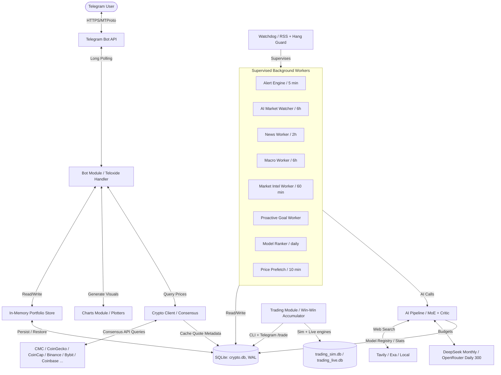

# Cryptograph Architecture

> [!NOTE]
> For a detailed walkthrough of all database schemas, news aggregation engines,
> and consensus algorithms (complete with Mermaid diagrams), refer to the
> **[Complete System Guide](system_guide.md)**. For the AI request lifecycle and
> model orchestration, see **[AI Pipeline & Model Orchestration Guide](ai_pipeline_guide.md)**.

Cryptograph is a zero-trust, memory-first crypto portfolio intelligence Telegram
bot written in Rust. It compiles to a single efficient binary and is designed
for maximum privacy, security, and low latency, running entirely on free API
tiers.

## Core Components

### 1. Telegram Bot & FSM Engine (`src/bot/`)
- **Framework**: `teloxide` library utilizing long-polling.
- **Access Control (ACL)**: a strict middleware system restricts access only to
  IDs listed in `ALLOWED_ADMIN_IDS`. Unapproved users are rejected at the entry
  point.
- **FSM Wizard Workflow**: state-machine multi-step interactive workflows
  (adding price alerts, registering wallets) avoid raw slash-command parameters.
- **NLP Engine**: token-matching parser that converts conversational text into
  structured commands.

### 2. Storage (`src/db/`)
- **SQLite-first** (`src/db/sqlite.rs`): a single `crypto.db` (WAL mode) holds
  users, goals, memos, news summaries, macro cache, price history/milestones,
  model health, usage budgets, and the model registry/stats. The schema
  self-migrates on every boot (`CREATE TABLE IF NOT EXISTS` + safe
  `ALTER TABLE ... ADD COLUMN`).
- **In-memory `Store`** (`src/db/store.rs`): hot portfolio state (purchases,
  wallets, alerts, settings) lives in RAM for speed and is persisted to SQLite
  as versioned JSON on every mutation; goals and memos live in dedicated tables
  so they survive even a rebuild of the `users` table.
- **Versioned JSON backups**: `/backup` exports a portable
  `cryptograph_backup.json`; `/restore` re-imports it. Plain JSON, **not
  encrypted** — treat backup files as sensitive.

### 3. Market Data Client (`src/crypto/`)
- **Consensus quotes**: fetches rates from many independent providers
  (CoinMarketCap, CoinGecko, CoinCap, CryptoCompare, Binance, Bybit, Coinbase,
  CoinPaprika, DefiLlama, DexScreener, GeckoTerminal) and applies outlier
  exclusion (median) to prevent single-point anomalies.
- **TTL caching** for real-time prices (60s) and market metrics (5 min) to stay
  within free-tier rate limits.
- **BYN/USD conversion** via the Belarus National Bank (NBRB) API, cached daily.
- **Deduplicated news aggregator**: parallel RSS polling (CoinTelegraph,
  CoinDesk, Decrypt, Blockworks, The Block, Bitcoin Magazine) merged and
  deduplicated by title.
- **News storage layer** (`news_articles` + `news_summary_history` tables): raw
  articles are deduped by URL and kept 7 days; per-symbol AI-verified summaries
  are appended to history (30-day retention). The AI prompt only ever sees
  compact fresh summaries (24h staleness guard); raw articles and summary
  history are available on demand via `news` CLI — no token burn on
  re-processing raw feeds.

### 4. Alert & Watchdog System (`src/alerts/`, `src/watchdog.rs`)
- **Alert engine**: wakes every 5 minutes, evaluates user alert rules against
  consensus prices, enforces cooldowns and two-consecutive-check deduplication.
- **Watchdog**: process-level guardian — RSS memory cap and hang detection with
  a heartbeat pinger; supervised workers auto-restart on panic (exponential
  backoff).

### 5. Blockchain Balance Poller (`src/crypto/blockchain.rs`)
- Wakes periodically (default 15 min) to verify balances of registered on-chain
  wallets (EVM, Solana, Bitcoin, Tron) via public explorer APIs; notifies on
  balance changes.

### 6. AI Agent Pipeline (`src/crypto/ai/`)
- **MoE double-checked pipeline** (`pipeline.rs`): two independent generators
  race, a reviewer merges/verifies, and a critic fact-checks every number
  against ground-truth market data. Hallucinated prices get corrected or
  rejected.
- **Provider fallback pool** (`providers.rs`, `pools.rs`): Gemini, Groq,
  Cerebras, Mistral, Nvidia, Cohere, Cloudflare, Hugging Face, OpenRouter
  (free tier), DeepSeek (paid, budget-capped) — automatic fallback on 429/503.
- **Budgets** (`deepseek_budget.rs`, `openrouter_budget.rs`): hard monthly cap
  for DeepSeek (default 3M tokens / 150 requests) and hard daily cap for
  OpenRouter (default 300 requests/day), enforced atomically and mirrored in
  SQLite (`monthly_usage`, `paid_usage`, `daily_usage`). Budgets hold a
  `Weak<SqliteStore>` so short-lived CLI processes exit cleanly.
- **Web search** (`search/`): Tavily / Exa first, then a free local fallback
  (DuckDuckGo HTML, Yahoo). The model emits `SEARCH: <query>` lines; the loop
  intercepts, searches, and feeds results back.
- **AI context blocks** (`src/crypto/ai/market_memory.rs`): `/ask` and the
  proactive worker receive pre-digested, token-cheap context — OHLCV candles
  with indicators (RSI, SMA, support/resistance, volatility) for the last 30/90
  days, a 30-day text trajectory, and a **trained-strategy block** (top
  `training_stats` configs per portfolio symbol) so the model grounds advice in
  what worked historically.
- **Background workers** (all supervised):
  - `news_worker` — 2h (1h under volatility) dual-agent news summarization.
  - `macro_worker` — 12h macro context (4h under volatility).
  - `market_intel_worker` — 60 min (30 min under volatility) on-chain/derivatives
    intel (BTC network, funding, open interest, stablecoin flows). Stores
    **raw deterministic metrics** — no LLM pass, the data is a fixed set of
    numbers that needs no interpretation.
  - `watcher` — 4h (2h under volatility) AI market watcher with severity
    levels and cooldowns.
  - `proactive_worker` — goal/memo scan with 2 gens → reviewer → critic and
    anti-FOMO / no-stale guardrails.
  - `model_ranker` — daily registry refresh + lazy benchmark batch (see below).
  - `price_prefetch` — 10 min price pre-fetch into SQLite.

### 7. Model Ranking System (`src/crypto/ai/model_rank.rs`)
- **Generalized lazy ranker across all providers**: discovers hand-configured
  `models.json` entries plus OpenRouter free-tier models (the models-list
  endpoint does not consume the 300/day budget), stores them in
  `model_registry`, and runs **at most 3 benchmarks per day** with a 30-day
  cooldown, fingerprint-change detection, and underperformance re-tests.
- **AI-judged benchmarks**: a non-OpenRouter judge (`gpt-oss-120b` via
  Groq/Cerebras) scores each candidate 0–10 per role (`main`, `critic`, `news`,
  `watcher`); the judge's own baseline is calibrated (`models calibrate`) and
  must stay above `JUDGE_MIN_BASELINE` for assignments to be written.
- **Role assignment**: models above role thresholds are written to
  `models.openrouter.json`, which `load_all_models()` merges into the pools
  (ranked entries win over `models.json` for the same alias+provider).
- **Stats**: `model_stats` tracks calls/errors/latency/quality per model per
  day; quality averages over benchmark calls only (`bench_calls`), so production
  traffic cannot dilute judge scores.
- **CLI**: `cargo run -- models refresh|list|rank|stats [days]|calibrate`.

### 8. Trading Module (`src/trading/`) — Win-Win Accumulator
- **Pluggable, dual-mode**: `SIMULATION` (paper, `trading_sim.db`) and `LIVE`
  (`trading_live.db`) engines share one schema; the CLI defaults to sim.
- **ATH guard**: the engine refuses to buy near the recent all-time high
  (`ath_lookback_days`, `max_buy_from_high_pct`) — it parks cash instead of
  chasing tops (verified: no buy at the Nov-2021 peak).
- **Specific-lot accounting**: every buy opens a lot with entry price, fees,
  cost basis, and a target exit price computed from the no-loss invariant:
  `amount * exit * (1 - fee) >= cost_basis * (1 + min_profit_margin)`.
- **No-loss enforcement**: a sell below the invariant is hard-rejected at both
  plan and execution layers; underwater lots transition to `COLD_HOLD` and
  become long-term DCA holdings until price recovers.
- **Operator constraints**: price ceilings/floors, pause-buy/pause-sell, and
  drawdown steps are persisted per allocation and checked on every tick.
- **Profit routing**: `REINVEST` (compounds into the pool), `SEPARATE`
  (parks profit in a reserve), or `PARTIAL(f)` (fraction to reserve, rest
  reinvested); cumulative profit is tracked per allocation.
- **Backtesting**: `trade backtest` replays real history through the engine with
  multi-source failover (Binance → CryptoCompare → CoinGecko); `--batch` sweeps
  rolling windows over 2020–2026 for BTC/ETH/SOL/LINK and reports
  equity/PnL/win-rate. Windows with too few candles (pre-listing noise, e.g.
  SOL before Aug 2020) are skipped.
- **Strategy catalog & self-tuning**: builtin profiles (e.g.
  `Win-Win-Accumulator`) plus trained profiles from config sweeps; `trade tune`
  lets a model propose `EngineConfig` changes gated by a deterministic
  validator. `trade strategy train --grid-full --threads N` parallelizes the
  candidate sweep; `trade seed` bundles the best profiles + lessons + stats
  into `data/trading_sim_seed.db`, which `TradingStore::open` copies into place
  on first run — the bot never starts from zero.
- **Commander / advice mode**: `trade recommend buy|sell|list|execute|reject|
  expire|parse` plans trades with full guardrail checks, records them as
  PENDING advice, and accepts plain-language operator reports
  ("купил ETH за 1800") via `recommend parse` — the operator executes on their
  own exchange and the bot mirrors the fill with re-checked guardrails.
- **Trade-task advisor**: `trade task add|list|pause|resume|advise|sim|grid`
  creates standing tasks with a monthly budget, alerts/day cap, and tranches;
  `task sim`/`task grid` replay the config over real history.
- **Exchange fees**: `trade fee --buy P --sell P` persists per-mode fee
  config; the engine's no-loss invariant and advisor sizing both account for
  fees.
- **Interface**: CLI (`cargo run -- trade ...`) + Telegram mirrors
  (`/trade`, `/tradetask`); DEX execution (Jupiter/Uniswap — no CEX, Belarus
  P2P legality) implemented up to quote/sign/reconcile — live swap
  submission needs wallet keys (operator signs in Phantom/MetaMask, the bot
  never holds the private key). See `docs/trading/`.

### 9. CLI Diagnostics & Scenarios
- `cargo run -- trade ...` — full trading module CLI (see `docs/trading/`).
- `cargo run -- news summary|history|articles|cleanup` — inspect the news
  store (fresh summaries, summary history, raw articles, retention sweep).
- `cargo run -- analyze <SYM>` — deep AI analysis in the terminal.
- `cargo run -- ask <user_id|demo> "question"` — replay the full `/ask`
  pipeline with prompts, web searches, drafts, and critic.
- `cargo run -- goal <demo|user_id> [-v]` — replay a proactive goal scan.
- `cargo run -- scenario <file.json> ["question"] [--fast]` — deterministic
  what-if: a scenario file replaces market/news/macro data and the **real**
  `/ask` + goal-scan pipeline runs against it (`CRYPTOGRAPH_FAST_MODELS=1`
  forces cheap watcher-tier models).
- `cargo run -- search "query"` — inspect only the web-search flow.
- `cargo run -- wipe-knowledge` — reset news/macro/milestone/health/stats
  caches, keeping users, goals, memos, and usage budgets.