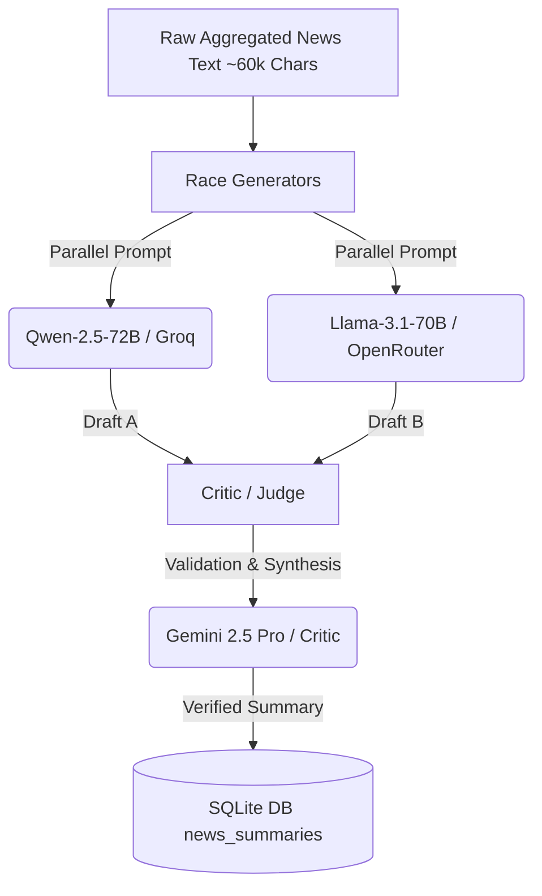

# Cryptograph System Brain & Scheduler Guide

This document describes the inner workings of Cryptograph's background scheduling, data pipelines, model contexts, and automated tasks. It is designed to explain exactly how the bot processes data, runs AI pipelines, caches results, and executes tasks.

---

## 1. Background Workers & Schedulers (What runs when?)

Cryptograph runs several asynchronous background loops powered by `tokio::spawn`. These workers monitor the market, fetch news, perform safety checks, and optimize operations.

### A. AI News Worker (`news_worker.rs`)
* **Trigger Interval:** Every **2 hours** by default.
* **Volatility Boost (Adaptive Scheduling):** The worker checks hourly quotes of all assets in user watchlists. If any asset exhibits volatility (change $\ge 2\%$ in 1 hour or $\ge 5\%$ in 24 hours), the worker **shortens its sleep interval to 1 hour**.
* **What it does:**
  1. Compiles a unique list of watched cryptocurrency symbols (plus a special `"GENERAL"` market query).
  2. Queries 6 parallel RSS feeds and raw APIs (CoinTelegraph, CoinDesk, Decrypt, Blockworks, The Block, and Bitcoin Magazine).
  3. Deduplicates and merges articles, extracting title, body, and source.
  4. Runs the massive **Mixture of Experts (MoE) dual-agent pipeline** to compress and verify the data.
  5. Saves the final verified news summary to the SQLite database `news_summaries` table.

### B. Macro Intelligence Worker (`macro_worker.rs`)
* **Trigger Interval:** Every **6 hours**.
* **What it does:**
  1. Gathers macroeconomic markers (Federal Reserve interest rates, US inflation/CPI trends, global liquidity markers).
  2. Pulls macro-focused news snippets from general financial news sources.
  3. Synthesizes a high-level macro context using an AI summarization model.
  4. Writes the result to the SQLite `macro_cache` table.

### C. Alert Evaluation Engine (`engine.rs`)
* **Trigger Interval:** Every **5 minutes**.
* **What it does:**
  1. Reads all active user alerts (price triggers, volatility metrics).
  2. Pulls fresh consensus prices from the providers.
  3. Checks condition matches (e.g., `BTC > $100,000` or `ETH drops 5% in 1h`).
  4. If a match occurs, triggers an alert notification and generates an AI-powered commentary describing why the price moved (using cached news).

### D. Provider Health Worker (`health_worker.rs`)
* **Trigger Interval:** Every **15 minutes**.
* **What it does:**
  1. Pings the configured LLM API endpoints (Groq, OpenRouter, Gemini, Mistral).
  2. Measures latency and successful ping rates.
  3. Updates the local SQLite `model_health` table.
  4. Demotes down/unhealthy providers and shifts them to the end of the backup pool to prevent system-wide outages.

---

## 2. Data Volume & Aggregation Details

### How many aggregators are queried?
1. **News Sources (6 parallel RSS Feeds):**
   * Cointelegraph
   * CoinDesk
   * Decrypt
   * Blockworks
   * The Block
   * Bitcoin Magazine
2. **On-Chain & Market Data Sources:**
   * CoinMarketCap API
   * Binance API
   * National Bank of the Republic of Belarus (NBRB) API (for local currency BYN conversion)
3. **Web Search Fallbacks (Tavily, Exa, DuckDuckGo HTML, Yahoo):**
   * Used dynamically by the LLM when it detects that the pre-cached database lacks specific real-time facts.

### How much raw data is processed?
* **Raw RSS Ingestion:** Each feed ingestion downloads up to 30 items. This represents $\approx 180$ raw articles per cycle.
* **Text volume:** The raw payload of these articles easily exceeds **150,000 characters ($\approx 30,000$ tokens)**.
* **Filtering & Truncation:** To fit model context windows efficiently and save tokens, the RSS parser strips HTML tags and truncates each article body to a maximum of **800 characters**.
* **Max ingestion cap:** The worker limits the consolidated input for each coin's summary prompt to **60,000 characters ($\approx 12,000$ tokens)**.

---

## 3. The Mixture of Experts (MoE) Pipeline (How Models Process Data)

Instead of passing raw, verbose text directly to a single expensive model, Cryptograph splits the workload using a **Generator-Critic cascade**:



### Step 1: Parallel Draft Generation (Writers)
* The system invokes **two models in parallel** (e.g., `Qwen2.5-72B` and `Llama-3.1-70B`).
* They analyze the massive chunk of raw articles and extract a draft list of key facts, partnerships, and market events.
* Running cheap, high-context models on Groq/OpenRouter is highly cost-effective for reading long texts.

### Step 2: Critic Validation & Synthesis (Judge)
* The two drafts (Draft A and Draft B) are sent to a smart judge model (`Gemini 2.5 Pro` or `Llama-3.3-70B`).
* The judge compares the drafts, removes contradictions, and reconciles them against actual pre-calculated numbers (prices, % changes, peaks).
* **Crucial Rule:** The judge is forbidden from calculating percentages or values itself. It must strictly inject verified numbers from the database to eliminate hallucinations.
* The output is a highly condensed, bullet-pointed **Verified Summary** ($\approx 1,500$ characters).

---

## 4. Cache & Database Strategy (Why it is lightning-fast)

To avoid triggering expensive search and MoE cycles on every user interaction, Cryptograph relies on local caching:

```
[User Ask Command] 
       │
       ▼
[Read User Portfolio] ──► [Fetch Live Prices] ──► [Read Pre-Cached News from SQLite]
                                                               │
                                                               ▼
                                               [Generate AI Response in 2-3s]
```

* When you run `/ask` or talk to the bot, it does **not** fetch RSS feeds.
* Instead, it queries the SQLite database for the pre-calculated, verified news summary of the corresponding token.
* This makes the Telegram response take only **2 to 3 seconds** and costs zero API credits for most runs, while keeping the advice grounded in fresh data.
* Direct web search is only triggered as a last resort if you ask about highly specific recent events or unindexed tokens.
