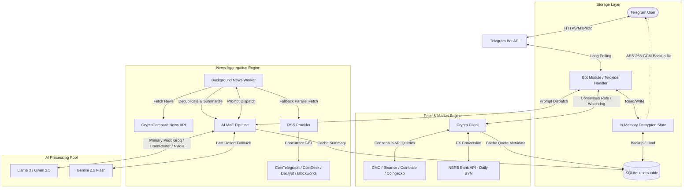
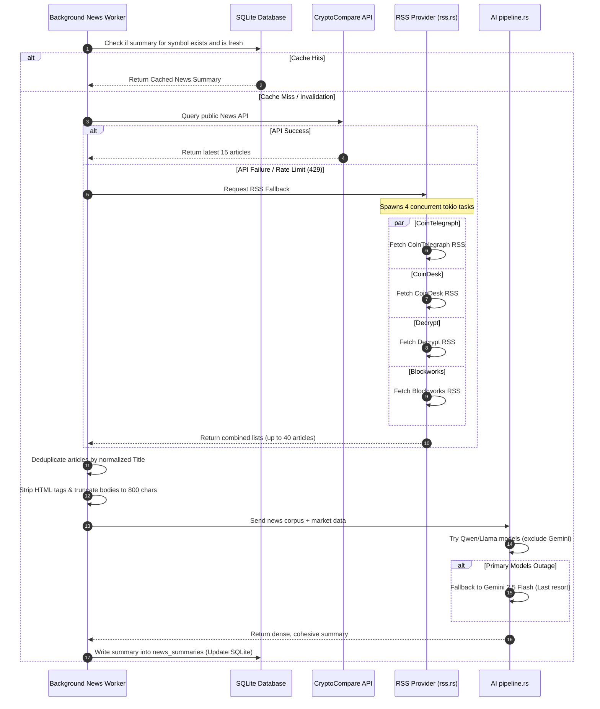
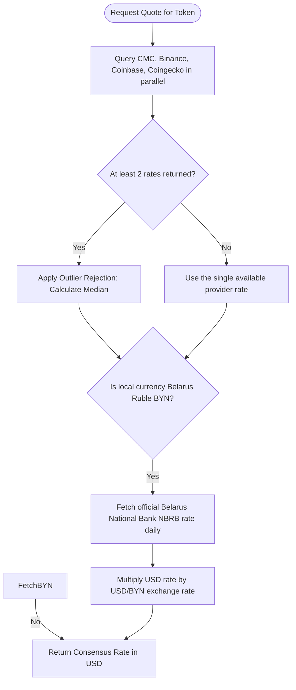
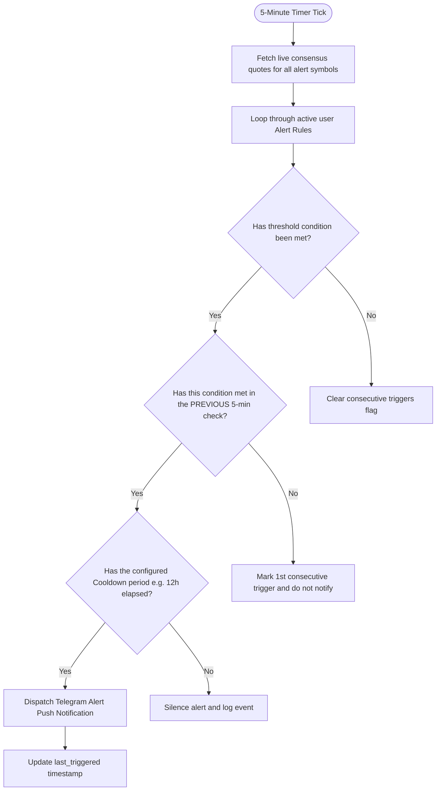

# Cryptograph Complete System Guide

This guide describes the core architecture, data pipelines, database models, and algorithm workflows of Cryptograph. It is designed to help engineers understand exactly how data flows through the application and how various modules interact.

> [!TIP]
> For a detailed overview of AI model pools, request payloads, and dynamic promotion/routing logic, read the **[AI Pipeline & Model Orchestration Guide](docs/ai_pipeline_guide.md)**.

---

## 🏗️ 1. High-Level System Architecture

Cryptograph is a zero-trust, memory-first cryptocurrency portfolio tracker Telegram bot built in Rust. It utilizes Teloxide for event-driven bot commands, keeps active user portfolios in RAM, and leverages SQLite for non-sensitive public metadata caching.

### Architectural Diagram

---

## 📰 2. News Aggregation Engine

The News Aggregation Engine runs dynamically and concurrently to feed the AI pipelines with high-quality market context while bypassing API limits and outages.

### Step-by-Step Flow

---

## 💾 3. Database & Storage Architecture

Cryptograph divides data into two sections based on trust and sensitivity:
1. **Sensitive Portfolio Data**: Saved in-memory during execution, backed up via AES-256-GCM encryption.
2. **Public Market Metadata & Cache**: SQLite cache database (`cryptograph_cache.db` or `crypto.db`).

### Schema Definitions

The SQLite database contains the following tables:

#### 1. `users`
Stores user-encrypted binary portfolios. If the server restarts, this table initializes the RAM store.
- `id` (INTEGER PRIMARY KEY): Telegram User ID.
- `portfolio_data` (BLOB NOT NULL): Serialized JSON encrypted using AES-256-GCM (random 96-bit nonce, key derived from `MASTER_KEY`).
- `last_updated` (DATETIME): Timestamp of last backup.

#### 2. `news_summaries`
Caches the synthesized multi-source news digests.
- `symbol` (TEXT PRIMARY KEY): Cryptocurrency symbol in uppercase (e.g. `BTC`, `ETH`, `GENERAL`).
- `summary` (TEXT NOT NULL): AI-generated Markdown/Plaintext bulleted summary.
- `updated_at` (DATETIME): Timestamp of last worker cycle.

#### 3. `quote_meta_cache`
Caches non-real-time token metadata (rank, supply, historical percentage changes) to prevent API rate-limiting.
- `symbol` (TEXT PRIMARY KEY)
- `rank` (INTEGER NOT NULL)
- `circulating_supply` (REAL NOT NULL)
- `change_1h` / `change_24h` / `change_7d` / `change_30d` / `change_90d` (REAL)
- `changes_updated_at` (DATETIME)
- `updated_at` (DATETIME)

#### 4. `price_history` & `events`
Logs historical price points (for volatility metrics) and user-triggered audit logs. Kept for a maximum of 30 days (auto-cleaned via `CleanupOldEvents`).

---

## ⚙️ 4. Core Algorithmic Workflows

### 📊 Algorithmic Multi-Provider Price Consensus

To avoid anomalies or single-point-of-failure issues with free API providers:

---

### 🧠 Mixture of Experts (MoE) Validation Pipeline

For complex analytics commands (`/ai` or `/advice`), a dual-agent validation loop prevents hallucinations.

---

### 🔔 Alert Engine Watchdog & Anti-Spam Workflow

Alerts run on a 5-minute tick background loop.

