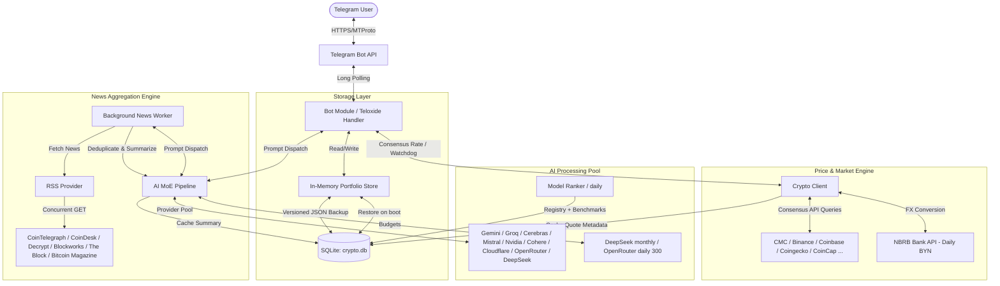
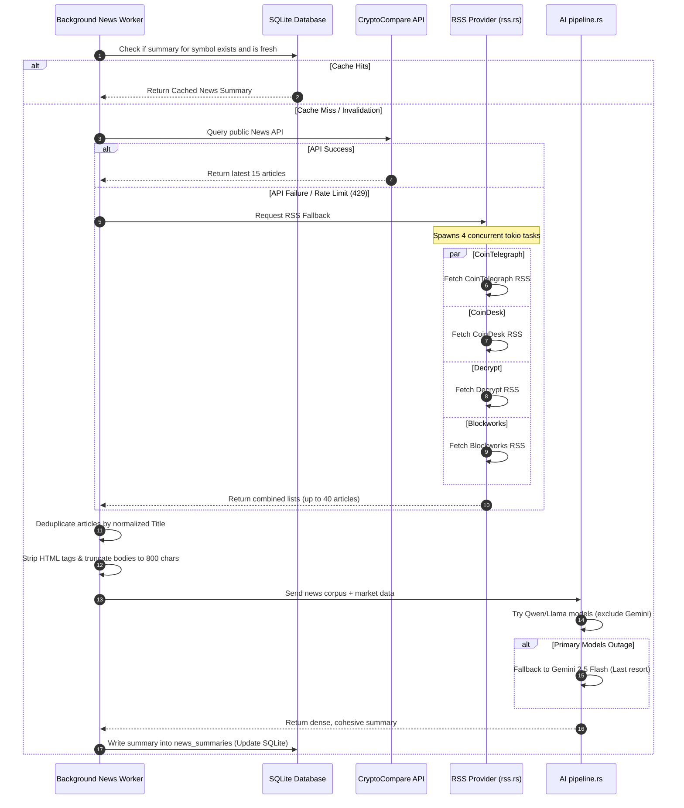
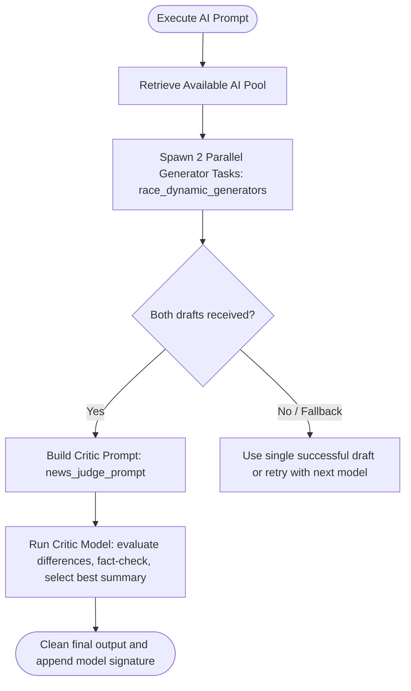

# Cryptograph Complete System Guide

This guide describes the core architecture, data pipelines, database models, and algorithm workflows of Cryptograph. It is designed to help engineers understand exactly how data flows through the application and how various modules interact.

> [!TIP]
> For a detailed overview of AI model pools, request payloads, and dynamic promotion/routing logic, read the **[AI Pipeline & Model Orchestration Guide](ai_pipeline_guide.md)**.

---

## 🏗️ 1. High-Level System Architecture

Cryptograph is a zero-trust, memory-first cryptocurrency portfolio tracker Telegram bot built in Rust. It utilizes Teloxide for event-driven bot commands, keeps hot portfolio state in RAM, and persists everything — users, goals, memos, caches, budgets, model telemetry — in a single SQLite database (`crypto.db`, WAL mode) that self-migrates on every boot.

### Architectural Diagram

---

## 📰 2. News Aggregation Engine

The News Aggregation Engine runs dynamically and concurrently to feed the AI pipelines with high-quality market context while bypassing API limits and outages.

### Step-by-Step Flow

---

## 💾 3. Database & Storage Architecture

Cryptograph divides data into two layers based on trust and sensitivity:
1. **User data (portfolios, goals, memos)**: persisted in SQLite (`users` as
   versioned JSON, `user_goals` / `user_memos` as dedicated tables) and loaded
   into RAM on boot. Backups are portable plain-JSON files — **not encrypted**.
2. **Public market metadata & caches**: SQLite tables (`quote_meta_cache`,
   `price_history`, `news_summaries`, `macro_cache`, `price_milestones`,
   `model_health`) rebuilt automatically from external APIs if deleted.

### Schema Definitions

The SQLite database contains the following tables:

#### 1. `users`
Stores the serialized portfolio JSON per Telegram user. On restart this table
re-initializes the RAM store.
- `id` (INTEGER PRIMARY KEY): Telegram User ID.
- `portfolio_data` (BLOB NOT NULL): Serialized JSON (`BackupEnvelope`).
- `last_updated` (DATETIME): Timestamp of last backup.

#### 2. `news_summaries`
Caches the synthesized multi-source news digests.
- `symbol` (TEXT PRIMARY KEY): Cryptocurrency symbol in uppercase (e.g. `BTC`, `ETH`, `GENERAL`).
- `summary` (TEXT NOT NULL): AI-generated Markdown/Plaintext bulleted summary.
- `updated_at` (DATETIME): Timestamp of last worker cycle.

#### 3. `quote_meta_cache`
Caches non-real-time token metadata (rank, supply, historical percentage changes) to prevent API rate-limiting.
- `symbol` (TEXT PRIMARY KEY)
- `rank` (INTEGER NOT NULL)
- `circulating_supply` (REAL NOT NULL)
- `change_1h` / `change_24h` / `change_7d` / `change_30d` / `change_90d` (REAL)
- `changes_updated_at` (DATETIME)
- `updated_at` (DATETIME)

#### 4. `price_history` & `events`
Logs historical price points (for volatility metrics and the AI trajectory
memory) and user-triggered audit logs. Kept for a maximum of 30 days
(auto-cleaned via `CleanupOldEvents`).

#### 5. `user_memos` / `user_goals` / `proactive_cache`
Standing AI memory (hard rules), user goals with progress + verdicts, and the
last proactive scan snapshot. These survive cache wipes and `users` rebuilds.

#### 6. Budget tables — `monthly_usage`, `paid_usage`, `daily_usage`
Token/request counters for the DeepSeek monthly cap and the OpenRouter daily
300-request cap, mirrored in RAM by the budget singletons.

#### 7. Model ranking tables — `model_registry`, `model_stats`
Discovered models (with fingerprints and test state) and per-model daily
calls/errors/latency/quality. `model_stats.bench_calls` counts only
benchmark calls, so production traffic cannot dilute judge quality scores.

#### 8. Trading tables (`trading_sim.db` / `trading_live.db`)
`operator_constraints`, `strategy_allocations`, `trade_lots`, `agent_debates`,
`trade_executions`, `backtest_runs`, `strategy_lessons`, `engine_configs`,
`strategy_profiles` — see [Database & Data Models](database.md) §4.

---

## ⚙️ 4. Core Algorithmic Workflows

### 📊 Algorithmic Multi-Provider Price Consensus

To avoid anomalies or single-point-of-failure issues with free API providers:

---

### 🧠 Mixture of Experts (MoE) Validation Pipeline

For complex analytics commands (`/ai` or `/advice`), a dual-agent validation loop prevents hallucinations.

---

### 🔔 Alert Engine Watchdog & Anti-Spam Workflow

Alerts run on a 5-minute tick background loop.

