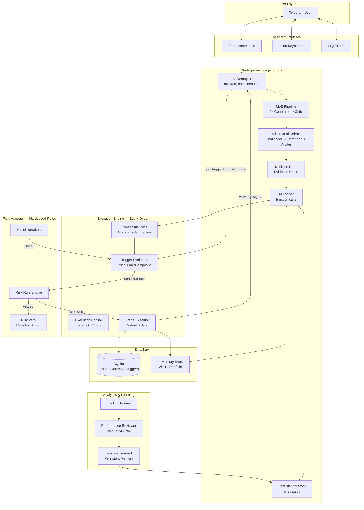

# Trading Architecture — Strategist / Executor Split

> **Status:** the shipped engine is event-driven: ticks arrive from a Telegram
> command or the CLI (`trade tick`, `/trade`), and there is no autonomous
> `tokio` loop. The paragraphs below describe the split that is actually in the
> code; anything the older sandbox design assumed about a permanent loop is
> marked as design.

## Design Philosophy

The system follows a **Strategist–Executor separation** pattern:

- **AI (Strategist):** Analyses market data and proposes *algorithmic triggers* when invoked. The AI never executes trades directly — it only sets conditions.
- **Execution Engine (Algorithm):** A deterministic function of `(config, market tick, portfolio state)`. It evaluates triggers against consensus prices and enforces every risk rule when it is called.
- **Risk Manager (Hardcoded):** Operator constraints and the no-loss invariant sit between the Engine and the portfolio. The AI has no way to bypass them: a blocked action is simply returned as a veto with a reason.

This architecture prevents AI hallucinations from causing financial damage, while still allowing the AI to learn and improve its strategy over time.

---

## System Diagram



---

## Component Breakdown

### 1. Strategist surface (`src/trading/advisor.rs`, `analyze.rs`, `debate.rs`, `tuner.rs`)

The strategist is invoked, not scheduled: `trade task advise`, `trade
recommend …`, `trade analyze` and `trade tune` gather the market snapshot and
the portfolio state, build a prompt, and return structured advice. The model
never writes to the ledger directly — the result is stored as a recommendation
or a learning note for the operator.

### 2. Execution Engine (`src/trading/engine.rs`)

A deterministic object, not a background task. `TradingEngine::new(config)`
builds it from a stored `engine_configs` row, then each call to `plan_buy` /
`plan_sell` takes a `MarketTick` plus the current lots and returns a
`Decision<BuyPlan|SellPlan>`. Applying a plan is a separate, explicit step
(`execute_buy` / `execute_sell`), which is what makes simulation and live modes
the same code path.

- Evaluates the tick against operator constraints, the ATH guard and the trend filter
- Applies the no-loss invariant to every exit
- Persists fills to `trade_executions` and updates the `trade_lots` ledger
- Returns a veto reason instead of silently skipping

### 3. Risk layer (`src/trading/store/types.rs`, `engine.rs`)

Risk is data + invariant, not a separate service:

- `operator_constraints` rows (ceiling / floor / drawdown step / pause flags) are loaded before each evaluation
- The no-loss invariant is a pure function of cost basis, amount, target price and fee
- Blocked actions return a typed reason that the CLI and Telegram render verbatim
- Some rules depend on portfolio state (drawdown from recent high, run-up from recent low) and are evaluated per tick

### 4. Strategy layer (`src/trading/strategies.rs`, `regime.rs`)

Instead of AI-authored triggers, the module uses versioned **strategy profiles**
and a regime classifier:

| Concept | Description |
|---|---|
| `StrategyProfile` | Named engine config + default constraints, builtin / trained / manual |
| `trade regime` | Classifies the market and selects the profile that historically fits it |
| `trade rule` | Operator overrides, always outranking the profile |
| Tranches | Dip-tranche sizing derived from the profile's drop thresholds |

### 5. Data Flow

```
Advisor / CLI:
  Read state -> evaluate -> recommendation (PENDING) -> operator executes -> reconcile

Engine tick:
  MarketTick -> constraints -> plan -> invariant check -> execute -> ledger

User interaction:
  Telegram -> handler -> engine / advisor -> ledger + response
```

---

## Integration with Existing System

The trading module leverages existing infrastructure:

| Existing Module | Reused For |
|---|---|
| `crypto/consensus.rs` | Multi-provider price feeds for trigger evaluation |
| `crypto/ai/pipeline.rs` | MoE Generator-Critic pattern for trade decisions |
| `crypto/ai/prompts.rs` | Prompt templates extended for trading context |
| `db/sqlite.rs` | SQLite persistence for trades, triggers, journal |
| `db/store.rs` | In-memory RAM store for virtual portfolio |
| `models/memo.rs` | AI reasoning persistence |
| `models/goal.rs` | Pattern for trigger lifecycle management |
| `bot/state.rs` | FSM wizards for risk configuration |
| `bot/keyboards.rs` | Inline keyboards for Trading Control Panel |
| `alerts/engine.rs` | Interval-based evaluation pattern for Execution Engine |

---

## What This Architecture Prevents

| Problem | Solution |
|---|---|
| AI hallucinates a price | MoE Critic cross-references against consensus snapshot |
| AI panic-sells in a crash | Max Drawdown Lock vetoes selling below 50% of entry |
| AI over-concentrates in one asset | Max 40% portfolio concentration rule |
| AI trades too frequently | 24h cooldown per asset, max daily trade limit |
| AI ignores user instructions | Strategy memos injected into every prompt |
| AI loses all capital | Profit lock-in preserves original capital after 2x |
| Flash crash triggers all orders | Circuit breaker halts all trading on >15% BTC drop |
| AI repeats a losing pattern | Lessons Learned memory prevents repeating past mistakes |
| Market data feed is manipulated | Consensus median across 3+ providers with outlier detection |
| Bot goes offline | All triggers have TimeDecay expiry; dead man's switch |
