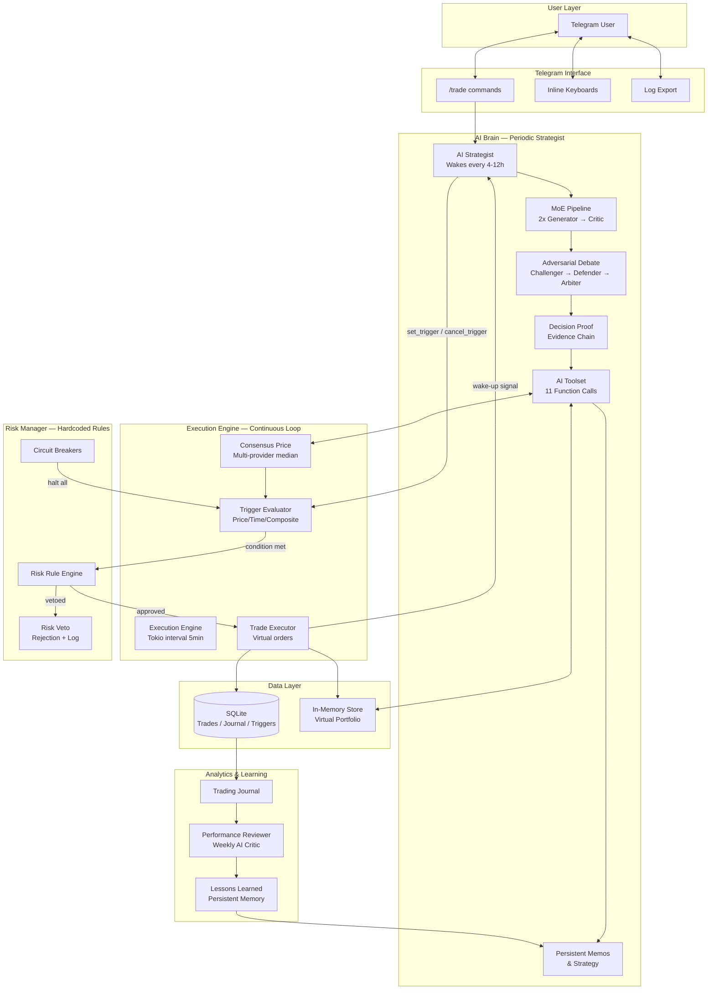

# Paper Trading Sandbox — Architecture

## Design Philosophy

The system follows a **Strategist–Executor separation** pattern:

- **AI (Strategist):** Wakes up periodically (every 4–12h). Analyzes market data, reviews past decisions, and submits *algorithmic triggers* to the Execution Engine. The AI never executes trades directly — it only sets conditions.
- **Execution Engine (Algorithm):** Runs continuously (every 5 min tick). Evaluates triggers against live consensus prices. Executes virtual trades instantly when conditions are met. Enforces all risk rules.
- **Risk Manager (Hardcoded):** Sits between the Engine and the virtual portfolio. Vetoes any action that violates safety rules. The AI has zero access to this layer.

This architecture prevents AI hallucinations from causing financial damage, while still allowing the AI to learn and improve its strategy over time.

---

## System Diagram



---

## Component Breakdown

### 1. AI Brain (`src/trading/ai_brain.rs`)

The strategist loop runs on a configurable interval (default: 6 hours). Each cycle:

1. **Wake:** Triggered by timer OR by trade execution event
2. **Gather Context:** Calls `read_market_snapshot`, `get_portfolio_state`, `list_active_triggers`, `read_memos`, `get_macro_context`
3. **Think:** Runs through MoE pipeline (2 Generators → 1 Critic)
4. **Act:** Outputs structured JSON with actions: `set_trigger`, `cancel_trigger`, `write_memo`
5. **Journal:** Full reasoning chain saved to `TradingJournal`
6. **Sleep:** Until next cycle

### 2. Execution Engine (`src/trading/engine.rs`)

A background `tokio::spawn` task with a 5-minute interval:

- Fetches consensus prices for all tracked assets
- Evaluates every `ActiveTrigger` against current prices
- On condition match → routes through Risk Manager → executes virtual trade
- Updates virtual portfolio in RAM + persists to SQLite
- Sends wake-up signal to AI Brain

### 3. Risk Manager (`src/trading/risk.rs`)

A pure function that takes a proposed trade and returns `Approved` or `Vetoed(reason)`:

- Stateless — no internal memory, only rules
- Called synchronously before every trade execution
- Vetoes are logged with full context for later analysis
- Some rules use portfolio state (passed as argument), not mutable

### 4. Trigger System (`src/trading/triggers.rs`)

Triggers are algorithmic conditions set by the AI:

| Condition | Description |
|---|---|
| `PriceBelow` | Execute when price drops to target |
| `PriceAbove` | Execute when price rises to target |
| `TrailingStop` | Activate after X% profit, trail by Y% step |
| `TakeProfit` | Staged exit: sell 50% at +10%, 50% at +20% |
| `StopLoss` | Hard floor: sell all if price drops to X |
| `TimeDecay` | Auto-cancel if not triggered within N hours |

### 5. Data Flow

```
AI Cycle:
  Read State → Think → Set Triggers → Journal

Engine Tick:
  Fetch Prices → Eval Triggers → Risk Check → Execute → Update State

User Interaction:
  Telegram → Command Handler → Read/Write State → Response
```

---

## Integration with Existing System

The trading module leverages existing infrastructure:

| Existing Module | Reused For |
|---|---|
| `crypto/consensus.rs` | Multi-provider price feeds for trigger evaluation |
| `crypto/ai/pipeline.rs` | MoE Generator-Critic pattern for trade decisions |
| `crypto/ai/prompts.rs` | Prompt templates extended for trading context |
| `db/sqlite.rs` | SQLite persistence for trades, triggers, journal |
| `db/store.rs` | In-memory RAM store for virtual portfolio |
| `models/memo.rs` | AI reasoning persistence |
| `models/goal.rs` | Pattern for trigger lifecycle management |
| `bot/state.rs` | FSM wizards for risk configuration |
| `bot/keyboards.rs` | Inline keyboards for Trading Control Panel |
| `alerts/engine.rs` | Interval-based evaluation pattern for Execution Engine |

---

## What This Architecture Prevents

| Problem | Solution |
|---|---|
| AI hallucinates a price | MoE Critic cross-references against consensus snapshot |
| AI panic-sells in a crash | Max Drawdown Lock vetoes selling below 50% of entry |
| AI over-concentrates in one asset | Max 40% portfolio concentration rule |
| AI trades too frequently | 24h cooldown per asset, max daily trade limit |
| AI ignores user instructions | Strategy memos injected into every prompt |
| AI loses all capital | Profit lock-in preserves original capital after 2x |
| Flash crash triggers all orders | Circuit breaker halts all trading on >15% BTC drop |
| AI repeats a losing pattern | Lessons Learned memory prevents repeating past mistakes |
| Market data feed is manipulated | Consensus median across 3+ providers with outlier detection |
| Bot goes offline | All triggers have TimeDecay expiry; dead man's switch |
