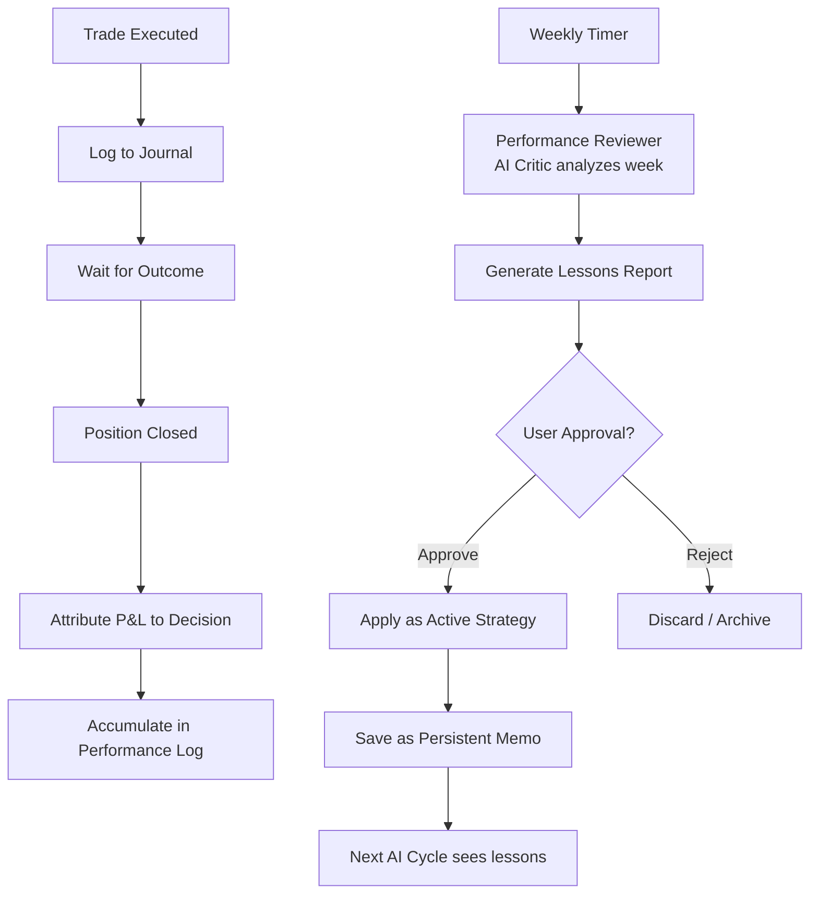

# Model Training & Learning System

The AI improves over time through a structured feedback loop: trade → review →
learn → apply. This is not traditional ML gradient descent — it's a
**cognitive learning system** where the AI analyzes its own performance and
adjusts its strategy through persistent memory.

---

## Learning Loop



---

## Performance Reviewer (Weekly AI Critic)

Once per week, a dedicated AI Critic analyzes all trades from the past 7 days
and produces a structured report.

### Reviewer Prompt

```text
You are a professional trading performance analyst. Review the following
week of paper trading activity and identify:

1. What strategies worked? (specific patterns that led to profits)
2. What strategies failed? (specific patterns that led to losses)
3. What patterns should be avoided? (recurring mistakes)
4. What adjustments should be made? (concrete, actionable changes)
5. Is the AI following the user's strategy directive?

## Weekly Performance Data

Total Trades: {total_trades}
Win Rate: {win_rate}%
Realized P&L: ${pnl}
Profit Factor: {profit_factor}
Max Drawdown: {drawdown}%

## Trade-by-Trade Breakdown

{trade_details_with_reasoning}

## Risk Vetoes This Week

{veto_details}

## Active Strategy Directives

{strategy_directives}

## Your Analysis

Output a structured report:

```json
{
    "week_summary": "Brief overall assessment (2-3 sentences)",
    "what_worked": [
        {
            "pattern": "Description of successful pattern",
            "evidence": ["Trade #X: +$Y", "Trade #Z: +$W"],
            "confidence": "high/medium/low"
        }
    ],
    "what_failed": [
        {
            "pattern": "Description of failing pattern",
            "evidence": ["Trade #A: -$B"],
            "root_cause": "Why this pattern failed",
            "confidence": "high/medium/low"
        }
    ],
    "lessons_learned": [
        "Concrete, actionable lesson 1",
        "Concrete, actionable lesson 2"
    ],
    "suggested_adjustments": [
        {
            "type": "strategy_rule / risk_param / memo",
            "description": "What to change",
            "rationale": "Why this change is needed",
            "expected_impact": "What should improve"
        }
    ],
    "strategy_adherence_score": "0-100 score on how well AI followed user directives",
    "improvement_trend": "improving / stable / declining"
}
```
```

### Reviewer Output Example

```json
{
    "week_summary": "Portfolio gained 2.1% this week with a 67% win rate. Strong performance on SOL swing trades (+8.3% avg) but ETH entries were consistently too early, resulting in -3.1% avg loss.",
    "what_worked": [
        {
            "pattern": "Buying SOL at 30-day support levels with 15% take-profit targets",
            "evidence": ["Trade #8: SOL +$28.50", "Trade #11: SOL +$12.30"],
            "confidence": "high"
        }
    ],
    "what_failed": [
        {
            "pattern": "Buying ETH immediately after a 5% daily drop without waiting for confirmation",
            "evidence": ["Trade #4: ETH -$22.00", "Trade #9: ETH -$8.50"],
            "root_cause": "ETH continued falling another 4-6% after entry. The AI entered on the first red candle instead of waiting for stabilization.",
            "confidence": "high"
        }
    ],
    "lessons_learned": [
        "Wait for at least 2 consecutive 4h candles of stabilization before buying a dip",
        "SOL swing trades work well with 15-20% take-profit targets on 7-14 day holds",
        "ETH requires wider stop-losses due to higher volatility relative to BTC"
    ],
    "suggested_adjustments": [
        {
            "type": "strategy_rule",
            "description": "Add rule: 'Do not buy an asset on the same day it drops >5%. Wait 24h for stabilization.'",
            "rationale": "Both ETH losing trades entered on the day of a sharp drop and got caught in continued downside.",
            "expected_impact": "Should reduce losing trades by avoiding falling knives."
        },
        {
            "type": "risk_param",
            "description": "Consider reducing max position size for ETH from 10% to 7% due to higher volatility",
            "rationale": "ETH volatility is 1.3x BTC; position sizing should reflect this.",
            "expected_impact": "More balanced risk across assets."
        }
    ],
    "strategy_adherence_score": 85,
    "improvement_trend": "improving"
}
```

---

## User Approval Flow

After the Performance Reviewer runs, the user receives a Telegram message:

```
📋 WEEKLY PERFORMANCE REVIEW
Aug 5, 2026

Summary: Portfolio +2.1% | Win Rate 67% | Improving ↗️

Top Finding:
✅ SOL swing trades working well (+8.3% avg)
❌ ETH entries too early (-3.1% avg)

Suggested Adjustments:
1. "Wait 24h after 5%+ drops before buying"
2. "Reduce ETH position size to 7%"

[✅ Apply All]  [📝 Review Details]  [❌ Dismiss]
```

- **Apply All:** Saves lessons as memos, updates strategy directive
- **Review Details:** Shows the full reviewer report
- **Dismiss:** Archives the report without applying

---

## Lessons Learned Memory

Approved lessons are saved as persistent memos with a special prefix:

```
[LESSON] 2026-08-05: Do not buy an asset on the same day it drops >5%.
Wait 24h for stabilization. Evidence: 2 ETH trades lost $30.50 total
when entering on drop day vs continued decline.

[LESSON] 2026-08-05: SOL swing trades with 15-20% take-profit targets
on 7-14 day holds perform well. Evidence: +$40.80 profit from 2 trades.
```

These memos are injected into every future AI cycle prompt under a dedicated
"Lessons Learned" section, ensuring the AI remembers and applies them.

---

## A/B Testing Framework (Future)

For more advanced learning, two AI strategies can run simultaneously:

```rust
pub struct ABTest {
    pub strategy_a: String,    // e.g., "Aggressive: 15% positions, tight stops"
    pub strategy_b: String,    // e.g., "Conservative: 5% positions, wide stops"
    pub capital_per_strategy: f64,
    pub started_at: DateTime<Utc>,
    pub results_a: StrategyResults,
    pub results_b: StrategyResults,
}
```

Each strategy gets half the virtual capital and runs independently. After a
configurable period (e.g., 2 weeks), the Performance Reviewer compares results
and recommends which strategy to adopt.

---

## Backtesting Harness (Future)

For offline learning, replay AI against historical data:

```rust
pub struct BacktestConfig {
    pub start_date: DateTime<Utc>,
    pub end_date: DateTime<Utc>,
    pub initial_capital: f64,
    pub ai_cycle_interval_hours: f64,
    pub data_source: HistoricalDataSource,
}
```

The AI runs through historical market data as if it were live, making decisions
at each cycle. Results are compared against:
- Buy & Hold benchmark
- DCA benchmark
- "Perfect" oracle (buy every bottom, sell every top)

This quantifies how much of the AI's performance is skill vs. market conditions.

---

## Feedback Quality Metrics

The learning system itself is measured:

| Metric | Target | Description |
|---|---|---|
| Lesson Application Rate | >70% | How often does the AI follow its own lessons? |
| Lesson Effectiveness | Positive P&L impact | Did applying the lesson improve results? |
| Reviewer Accuracy | >80% user approval | How often does the user agree with the reviewer? |
| Cycle Time | <5 min | How fast does the weekly review complete? |

---

## Anti-Regression Measures

To prevent the AI from "forgetting" important lessons:

1. **Lesson Priority Scoring:** Each lesson has a `priority` score (1–10) based on P&L impact. High-priority lessons are always injected; low-priority ones may be truncated if context is full.

2. **Lesson Expiry:** Lessons auto-expire after 90 days unless "renewed" by the Performance Reviewer. This prevents outdated advice from persisting.

3. **Contradiction Detection:** If a new lesson contradicts an existing one, the Reviewer flags it: "This contradicts Lesson #5 from July. Which is correct?"

4. **Lesson Effectiveness Tracking:** Each lesson tracks how often it was followed and what the outcome was. Ineffective lessons are deprecated.
